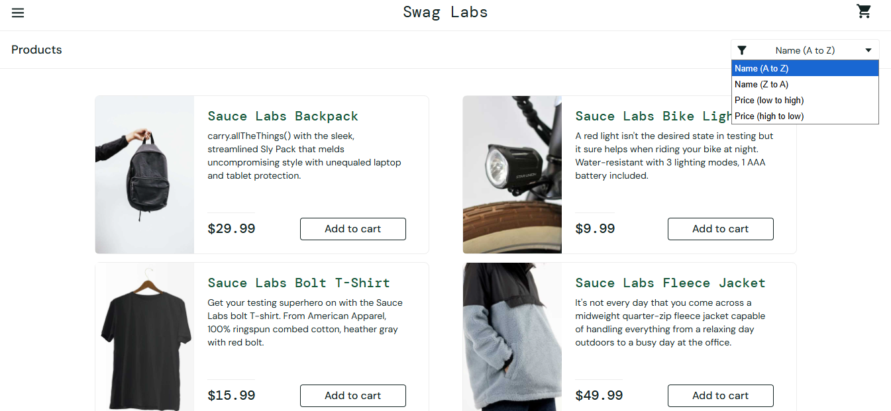
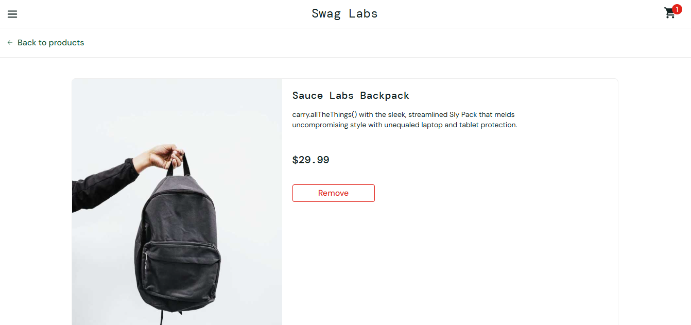

# Parte 1 — Especificação do Sistema (Swag Labs)

> Conteúdo da Parte 1 do trabalho (versão corrigida), convertido do `.docx` para servir de base aos casos de teste de caixa preta. **Fonte da verdade para os testes:** se o comportamento do sistema divergir do que está aqui, isso é um **defeito** a registrar em [04-incidentes.md](04-incidentes.md).

**Resumo:** Este trabalho aplica técnicas de Verificação e Validação de Software ao Swag Labs, e-commerce de demonstração da Sauce Labs. Nesta primeira parte são definidos o contexto do sistema, um cenário geral de uso e as user stories US001 a US008, com cenários de sucesso e de fracasso, regras de negócio e critérios de aceite, que embasam os testes de caixa preta da segunda parte.

**Sistema:** https://www.saucedemo.com · **Professora:** Dra. Jacilane Rabelo · **Disciplina:** Verificação e Validação de Software

## 1. O Sistema Testado: Swag Labs

### 1.1 Definição do Sistema

Pequenos comerciantes e empresas que vendem produtos promocionais (camisetas, mochilas, acessórios de marca) frequentemente dependem de canais informais de venda, como redes sociais ou pedidos por mensagem. Essa informalidade dificulta o controle dos pedidos, a padronização do processo de compra e a escalabilidade do negócio, e gera consequências como perda de vendas por falta de um processo claro de finalização, erros no cálculo de valores e baixa confiança do cliente no momento de concluir a compra.

O Swag Labs é uma solução do tipo e-commerce que endereça esse problema ao oferecer um fluxo de compra estruturado: autenticação de usuários, catálogo de produtos com ordenação por nome e por preço, página de detalhes de cada produto, carrinho de compras, checkout com cálculo de imposto e do valor total, confirmação do pedido e emissão de comprovante em PDF. O sistema também oferece um menu lateral com navegação, encerramento de sessão, reinício do estado da aplicação e variações do catálogo com carregamento dinâmico (Lazy Load, Spinner e Slider). Ao automatizar esse fluxo, o sistema reduz erros manuais no processo de venda, dá transparência ao cliente (itens, valores e status do pedido sempre visíveis) e padroniza a experiência de compra.

O sistema está disponível em https://www.saucedemo.com e foi desenvolvido pela Sauce Labs como ambiente público de demonstração para testes manuais e automatizados (Sauce Labs, 2026). As telas usadas como referência neste trabalho foram capturadas pela equipe durante a navegação no sistema com o usuário standard_user. A Figura 1 apresenta a página de produtos (“Products”), com o seletor de ordenação aberto, e a Figura 2 apresenta a página de detalhes de um produto já adicionado ao carrinho.



*Figura 1: Página “Products” do Swag Labs com o seletor de ordenação aberto. Fonte: capturada pelos autores em Sauce Labs (2026).*



*Figura 2: Página de detalhes do produto “Sauce Labs Backpack” com o item no carrinho. Fonte: capturada pelos autores em Sauce Labs (2026).*

### 1.2 Definição dos Artefatos

Um usuário acessa o Swag Labs e realiza login informando Username e Password. Após autenticado, ele é direcionado à página “Products” (Figura 1), onde visualiza o catálogo completo e pode ordená-lo por nome (A→Z ou Z→A) ou por preço (menor→maior ou maior→menor) para encontrar mais rapidamente o produto desejado. Ao clicar no nome ou na imagem de um produto, ele abre a página de detalhes (Figura 2) e lê a descrição completa e o preço. Ao decidir pela compra, adiciona o produto ao carrinho pelo botão “Add to cart” e, se mudar de ideia, remove-o pelo botão “Remove” na página “Your Cart”. Em seguida, inicia o checkout, informa First Name, Last Name e Zip/Postal Code (CEP de entrega), confere na tela “Checkout: Overview” os itens, o subtotal, o imposto e o total, e finaliza a compra, recebendo a confirmação do pedido e podendo gerar o comprovante em PDF. Durante a navegação, o usuário pode usar o menu lateral para voltar à listagem de produtos, reiniciar o estado da aplicação (esvaziando o carrinho sem sair do sistema), encerrar a sessão (logout) e visualizar o catálogo nos modos dinâmicos Lazy Load, Spinner e Slider.

As user stories a seguir seguem o formato “Eu, enquanto… / Quero… / Para…” proposto por Cohn (2004), e os cenários seguem a estrutura Dado/Quando/Então do Behaviour-Driven Development (North, 2006), de modo que cada cenário possa ser rastreado para os casos de teste de caixa preta da segunda parte (Delamaro, Maldonado & Jino, 2016). Os textos de botões, títulos e mensagens aparecem em inglês, exatamente como são exibidos pelo sistema.

Observação: a US001 (Realizar login) reproduz o exemplo do template, adaptado ao Swag Labs, e por isso não é contabilizada no mínimo exigido. As US002 a US008 compõem o escopo avaliado, totalizando 7 user stories e 22 cenários.

US – User Story; CE – Cenário; RN – Regra de Negócio.

## 2. User Stories

| US | Título | Prioridade | Cenários |
|---|---|---|---|
| [US001](#us001--realizar-login) | Realizar login | Essencial | 3 |
| [US002](#us002--ordenar-produtos-do-catálogo) | Ordenar produtos do catálogo | Essencial | 4 |
| [US003](#us003--adicionar-produto-ao-carrinho) | Adicionar produto ao carrinho | Essencial | 3 |
| [US004](#us004--remover-produto-do-carrinho) | Remover produto do carrinho | Essencial | 3 |
| [US005](#us005--finalizar-compra-checkout) | Finalizar compra (checkout) | Essencial | 3 |
| [US006](#us006--navegar-pelo-menu-lateral) | Navegar pelo menu lateral | Desejável | 3 |
| [US007](#us007--visualizar-catálogo-dinâmico) | Visualizar catálogo dinâmico | Desejável | 3 |
| [US008](#us008--visualizar-detalhes-de-um-produto) | Visualizar detalhes de um produto | Importante | 3 |

> A US001 reproduz o exemplo do template e **não conta** no mínimo exigido. Escopo avaliado: US002–US008 (7 US, 22 cenários).


### US001 — Realizar login

**Descrição:** Eu, enquanto usuário não autenticado do sistema, Quero realizar login informando meu Username e minha Password na tela inicial, Para acessar o catálogo de produtos e as demais funcionalidades do Swag Labs.

- **Ator:** Usuário não autenticado
- **Prioridade:** Essencial

**Entradas e pré-condições**

- O usuário deve possuir um Username cadastrado no sistema (ex.: standard_user).
- O usuário não pode estar bloqueado (ex.: locked_out_user).
- O usuário deve estar na tela de login (https://www.saucedemo.com).

**Saídas e pós-condições**

- Uma sessão autenticada é iniciada para o usuário.
- O sistema redireciona o usuário para a página “Products” (/inventory.html).

**CE001(US001) — Sucesso**

```gherkin
Cenário: CE001(US001) – Realizar login com credenciais válidas
  Dado que o usuário está na tela de login
  E o sistema apresenta os campos Username e Password e o botão “Login”
  Quando o usuário informa o Username “standard_user”
  E informa a Password correta
  E clica no botão “Login”
  Então o sistema autentica o usuário
  E redireciona para a página “Products”, exibindo o catálogo de produtos
```

**CE002(US001) — Fracasso**

```gherkin
Cenário: CE002(US001) – Realizar login com senha incorreta
  Dado que o usuário está na tela de login
  E preenche o campo Username com “standard_user”
  E preenche o campo Password com uma senha incorreta
  Quando o usuário clica no botão “Login”
  Então o sistema exibe a mensagem “Epic sadface: Username and password do not match any user in this service”
  E mantém o usuário na tela de login, sem conceder acesso
```

**CE003(US001) — Fracasso**

```gherkin
Cenário: CE003(US001) – Realizar login com usuário bloqueado
  Dado que o usuário está na tela de login
  E preenche o campo Username com “locked_out_user” e a Password correta
  Quando o usuário clica no botão “Login”
  Então o sistema exibe a mensagem “Epic sadface: Sorry, this user has been locked out.”
  E mantém o usuário na tela de login, sem conceder acesso
```

**Campos obrigatórios**

- O campo Username deve ser obrigatório.
- O campo Password deve ser obrigatório.
- O sistema deve impedir o login se algum dos campos estiver vazio.

**Regras de negócio**

- **RN01** – Se o campo Username estiver vazio, o sistema exibe “Epic sadface: Username is required”.
- **RN02** – Se o Username estiver preenchido e a Password vazia, o sistema exibe “Epic sadface: Password is required”.
- **RN03** – Credenciais que não correspondem a um usuário cadastrado são recusadas com a mensagem “Epic sadface: Username and password do not match any user in this service”.
- **RN04** – Usuários bloqueados não podem acessar o sistema, mesmo com a senha correta.

**Critérios de aceite**

- Deve autenticar e redirecionar para “Products” quando Username e Password forem válidos.
- Deve exibir a mensagem de campo obrigatório correspondente quando Username ou Password estiver vazio.
- Deve exibir a mensagem de credenciais inválidas quando a combinação Username/Password estiver incorreta.
- Deve exibir a mensagem de usuário bloqueado para locked_out_user.
- Deve permitir fechar a mensagem de erro pelo botão “X” exibido ao lado dela.


### US002 — Ordenar produtos do catálogo

**Descrição:** Eu, enquanto usuário autenticado do sistema, Quero ordenar a lista de produtos da página “Products” por nome (A→Z ou Z→A) ou por preço (menor→maior ou maior→menor), usando o seletor de ordenação do canto superior direito, Para localizar mais rapidamente o produto que procuro, comparando os itens pela ordem alfabética do nome ou pela faixa de preço que cabe no meu orçamento.

- **Ator:** Usuário autenticado
- **Prioridade:** Essencial

**Entradas e pré-condições**

- O usuário deve estar autenticado no sistema (US001).
- O usuário deve estar na página “Products” (/inventory.html), com o catálogo carregado e pelo menos 2 produtos exibidos.
- O seletor de ordenação deve estar visível, exibindo a opção atual (por padrão, “Name (A to Z)”).
- Como o Swag Labs não possui campo de pesquisa, a ordenação é aplicada sobre o catálogo completo, sem necessidade de busca prévia.

**Saídas e pós-condições**

- A lista de produtos é reexibida na ordem correspondente à opção escolhida.
- O seletor passa a exibir o nome da opção escolhida.
- A quantidade de produtos exibidos e os itens do carrinho permanecem inalterados.

**CE001(US002) — Sucesso**

```gherkin
Cenário: CE001(US002) – Ordenar produtos por preço, do menor para o maior
  Dado que o usuário autenticado está na página “Products”
  E o catálogo exibe os 6 produtos na ordem padrão “Name (A to Z)”
  Quando o usuário clica no seletor de ordenação
  E seleciona a opção “Price (low to high)”
  Então o sistema reexibe a lista com o produto mais barato primeiro (“Sauce Labs Onesie”, $7.99) e o mais caro por último (“Sauce Labs Fleece Jacket”, $49.99)
  E o seletor passa a exibir “Price (low to high)”
```

**CE002(US002) — Sucesso**

```gherkin
Cenário: CE002(US002) – Ordenar produtos por nome, de Z para A
  Dado que o usuário autenticado está na página “Products”
  Quando o usuário seleciona a opção “Name (Z to A)” no seletor de ordenação
  Então o sistema reexibe a lista em ordem alfabética decrescente, iniciando por “Test.allTheThings() T-Shirt (Red)” e terminando em “Sauce Labs Backpack”
  E o seletor passa a exibir “Name (Z to A)”
```

**CE003(US002) — Sucesso**

```gherkin
Cenário: CE003(US002) – Ordenar por preço produtos com o mesmo valor (desempate)
  Dado que o usuário autenticado está na página “Products”
  E existem dois produtos com o mesmo preço ($15.99): “Sauce Labs Bolt T-Shirt” e “Test.allTheThings() T-Shirt (Red)”
  Quando o usuário seleciona a opção “Price (low to high)”
  Então o sistema exibe os dois produtos em posições consecutivas
  E exibe “Sauce Labs Bolt T-Shirt” antes de “Test.allTheThings() T-Shirt (Red)”, aplicando a ordem alfabética como desempate
```

**CE004(US002) — Fracasso**

```gherkin
Cenário: CE004(US002) – Tentar ordenar o catálogo sem estar autenticado
  Dado que o usuário não realizou login (ou encerrou a sessão)
  Quando o usuário tenta acessar diretamente o endereço https://www.saucedemo.com/inventory.html para ordenar os produtos
  Então o sistema não exibe a página “Products” nem o seletor de ordenação
  E redireciona o usuário para a tela de login com a mensagem “Epic sadface: You can only access '/inventory.html' when you are logged in.”
```

**Campos obrigatórios**

- Não há campos de digitação nesta funcionalidade. O único elemento de entrada obrigatório é o seletor de ordenação, que deve oferecer exatamente as opções “Name (A to Z)”, “Name (Z to A)”, “Price (low to high)” e “Price (high to low)”.
- Cada produto da lista deve exibir imagem, nome, descrição, preço e botão “Add to cart” (ou “Remove”).

**Regras de negócio**

- **RN01** – Ao carregar a página “Products”, a lista é exibida na ordem padrão “Name (A to Z)”.
- **RN02** – A ordenação por nome deve ignorar diferenças entre letras maiúsculas e minúsculas.
- **RN03** – Na ordenação por preço, produtos com o mesmo valor devem ser exibidos em ordem alfabética crescente (A→Z) do nome.
- **RN04** – A ordenação altera apenas a ordem de exibição: não remove, duplica ou altera produtos, e não modifica o carrinho.
- **RN05** – Somente usuários autenticados podem acessar a página “Products” e o seletor de ordenação.

**Critérios de aceite**

- Deve exibir o seletor de ordenação com as quatro opções definidas, apenas para usuários autenticados.
- Deve reordenar a lista imediatamente após a escolha da opção, sem recarregar a página.
- Deve ordenar corretamente pelos quatro critérios (nome A→Z, nome Z→A, preço crescente e preço decrescente).
- Deve aplicar a ordem alfabética como desempate entre produtos de mesmo preço.
- Deve manter os 6 produtos e o contador do carrinho inalterados após a ordenação.
- Deve redirecionar para o login, com a mensagem definida no CE004, quem tentar acessar a página sem estar autenticado.


### US003 — Adicionar produto ao carrinho

**Descrição:** Eu, enquanto usuário autenticado do sistema, Quero adicionar um produto ao carrinho clicando no botão “Add to cart” na página “Products” ou na página de detalhes do produto, Para reservar os itens que pretendo comprar e seguir para o checkout.

- **Ator:** Usuário autenticado
- **Prioridade:** Essencial

**Entradas e pré-condições**

- O usuário deve estar autenticado no sistema (US001).
- O produto deve estar exibido na página “Products” ou na sua página de detalhes, com o botão “Add to cart”.
- O produto ainda não deve estar no carrinho.

**Saídas e pós-condições**

- O produto é incluído no carrinho com quantidade (QTY) igual a 1.
- O botão do produto passa a exibir “Remove”.
- O contador (badge) do ícone do carrinho é incrementado em 1.
- O produto passa a ser listado na página “Your Cart” com QTY, nome, descrição e preço.

**CE001(US003) — Sucesso**

```gherkin
Cenário: CE001(US003) – Adicionar produto ao carrinho pela página “Products”
  Dado que o usuário autenticado está na página “Products”
  E o carrinho está vazio (sem contador no ícone)
  Quando o usuário clica em “Add to cart” no produto “Sauce Labs Backpack”
  Então o botão do produto passa a exibir “Remove”
  E o ícone do carrinho passa a exibir o contador “1”
  E a página “Your Cart” lista “Sauce Labs Backpack” com QTY 1 e preço $29.99
```

**CE002(US003) — Sucesso**

```gherkin
Cenário: CE002(US003) – Adicionar produto ao carrinho pela página de detalhes
  Dado que o usuário autenticado abriu a página de detalhes do produto “Sauce Labs Backpack” (US008)
  E o carrinho está vazio
  Quando o usuário clica em “Add to cart”
  Então o botão passa a exibir “Remove” e o ícone do carrinho exibe o contador “1” (Figura 2)
  E ao clicar em “Back to products”, o mesmo produto aparece com o botão “Remove” na página “Products”
```

**CE003(US003) — Fracasso**

```gherkin
Cenário: CE003(US003) – Tentar adicionar mais de uma unidade do mesmo produto
  Dado que o produto “Sauce Labs Backpack” já está no carrinho
  E o botão desse produto exibe “Remove”
  Quando o usuário tenta adicionar uma segunda unidade do mesmo produto (pela listagem, pela página de detalhes ou pela página “Your Cart”)
  Então o sistema não oferece botão “Add to cart” nem campo para alterar a quantidade desse produto
  E o contador do carrinho permanece “1” e a página “Your Cart” mantém QTY 1 para o produto
```

**Campos obrigatórios**

- Botão “Add to cart” / “Remove” em cada produto.
- Contador numérico (badge) no ícone do carrinho.
- Na página “Your Cart”, cada item deve exibir obrigatoriamente: QTY, nome, descrição e preço.

**Regras de negócio**

- **RN01** – Cada produto pode ser adicionado uma única vez; a quantidade (QTY) é sempre 1 e não pode ser editada pelo usuário, portanto não existem quantidades zero, negativas ou decimais.
- **RN02** – O sistema não controla estoque: todo produto exibido no catálogo está disponível para ser adicionado.
- **RN03** – O contador do carrinho deve exibir a quantidade exata de produtos distintos no carrinho e deve ficar oculto quando o carrinho estiver vazio.
- **RN04** – O estado do botão (“Add to cart”/“Remove”) deve ser o mesmo na página “Products” e na página de detalhes.
- **RN05** – Os itens do carrinho devem permanecer enquanto o usuário navega entre as páginas do sistema durante a sessão.

**Critérios de aceite**

- Deve incluir o produto no carrinho ao clicar em “Add to cart”, tanto na listagem quanto na página de detalhes.
- Deve trocar o botão para “Remove” imediatamente após a adição.
- Deve incrementar o contador do carrinho em 1 a cada produto adicionado.
- Deve listar o produto em “Your Cart” com QTY 1, nome, descrição e preço iguais aos do catálogo.
- Não deve permitir adicionar a mesma unidade duas vezes nem alterar a QTY.
- Deve manter os produtos adicionados ao navegar entre listagem, detalhes e carrinho.


### US004 — Remover produto do carrinho

**Descrição:** Eu, enquanto usuário autenticado com produtos no carrinho, Quero remover do carrinho um produto que não desejo mais comprar, clicando no botão “Remove” desse produto na página “Your Cart”, Para que o pedido contenha somente os itens que realmente vou comprar e o valor do checkout fique correto.

- **Ator:** Usuário autenticado
- **Prioridade:** Essencial

**Entradas e pré-condições**

- O usuário deve estar autenticado no sistema (US001).
- O carrinho deve conter pelo menos um produto (US003).
- O usuário deve estar na página “Your Cart”, acessada pelo ícone do carrinho.

**Saídas e pós-condições**

- O produto removido deixa de ser listado na página “Your Cart”.
- O contador do carrinho é decrementado em 1, ou fica oculto se o carrinho ficar vazio.
- Na página “Products”, o botão do produto removido volta a exibir “Add to cart”.

**CE001(US004) — Sucesso**

```gherkin
Cenário: CE001(US004) – Remover um produto do carrinho com dois produtos
  Dado que o carrinho contém “Sauce Labs Backpack” e “Sauce Labs Bike Light” (contador “2”)
  E o usuário está na página “Your Cart”
  Quando o usuário clica em “Remove” no item “Sauce Labs Bike Light”
  Então o item “Sauce Labs Bike Light” deixa de ser listado
  E o contador do carrinho passa a exibir “1”
  E “Sauce Labs Backpack” continua listado com QTY 1
```

**CE002(US004) — Sucesso**

```gherkin
Cenário: CE002(US004) – Remover o último produto do carrinho
  Dado que o carrinho contém apenas “Sauce Labs Backpack” (contador “1”)
  E o usuário está na página “Your Cart”
  Quando o usuário clica em “Remove” nesse item
  Então a lista do carrinho fica vazia, mantendo apenas os cabeçalhos QTY e Description
  E o contador do carrinho deixa de ser exibido
  E ao clicar em “Continue Shopping”, o produto aparece com o botão “Add to cart” na página “Products”
```

**CE003(US004) — Fracasso**

```gherkin
Cenário: CE003(US004) – Tentar remover produto com o carrinho vazio
  Dado que o usuário não possui produtos no carrinho
  Quando o usuário clica no ícone do carrinho para acessar “Your Cart”
  Então o sistema exibe a página “Your Cart” sem itens e sem nenhum botão “Remove”
  E o ícone do carrinho permanece sem contador
  E o usuário pode voltar ao catálogo pelo botão “Continue Shopping”
```

**Campos obrigatórios**

- Botão “Remove” em cada item listado em “Your Cart”.
- Contador numérico (badge) no ícone do carrinho.
- Botão “Continue Shopping” na página “Your Cart”.

**Regras de negócio**

- **RN01** – A remoção é imediata e não exige confirmação.
- **RN02** – Como a QTY é sempre 1 (US003, RN01), “Remove” retira o produto inteiro do carrinho.
- **RN03** – A remoção de um produto não altera os demais itens do carrinho.
- **RN04** – O contador deve refletir a nova quantidade imediatamente e ficar oculto quando o carrinho estiver vazio.
- **RN05** – O estado do botão na página “Products” deve acompanhar a remoção feita em “Your Cart”.

**Critérios de aceite**

- Deve remover somente o item clicado ao acionar “Remove”.
- Deve decrementar o contador do carrinho em 1 a cada remoção.
- Deve ocultar o contador quando o último item for removido.
- Deve exibir “Add to cart” na página “Products” para o produto removido.
- Deve exibir a página “Your Cart” vazia, sem botões “Remove”, quando não houver itens.


### US005 — Finalizar compra (checkout)

**Descrição:** Eu, enquanto usuário autenticado com pelo menos um produto no carrinho, Quero finalizar a compra informando First Name, Last Name e Zip/Postal Code (CEP de entrega) na tela “Checkout: Your Information” e conferindo itens e valores na tela “Checkout: Overview”, Para concluir o pedido e gerar um comprovante em PDF com a data do pedido, o destinatário, os itens e os valores pagos.

- **Ator:** Usuário autenticado
- **Prioridade:** Essencial

**Entradas e pré-condições**

- O usuário deve estar autenticado no sistema (US001).
- O carrinho deve conter pelo menos um produto (US003).
- O usuário deve estar na página “Your Cart” e clicar em “Checkout”.

**Saídas e pós-condições**

- A tela “Checkout: Overview” exibe os itens, “Item total”, “Tax” e “Total”.
- Após clicar em “Finish”, o pedido é confirmado na tela “Checkout: Complete!” e o carrinho é esvaziado.
- O botão “Generate PDF order” baixa um comprovante contendo: data do pedido (Order Date).
- dados de entrega (Ship To: First Name, Last Name e Zip/Postal Code informados).
- itens (nome e preço).
- Item total, Tax e Total.

**CE001(US005) — Sucesso**

```gherkin
Cenário: CE001(US005) – Realizar compra com sucesso e gerar comprovante
  Dado que o carrinho contém “Sauce Labs Backpack” ($29.99)
  E o usuário clica em “Checkout” na página “Your Cart”
  Quando o usuário preenche First Name “Maria”, Last Name “Silva” e Zip/Postal Code “62900-000”
  E clica em “Continue”
  E confere na tela “Checkout: Overview”: Item total $29.99, Tax $2.40 e Total $32.39
  E clica em “Finish”
  Então o sistema exibe a tela “Checkout: Complete!” com a mensagem “Thank you for your order!”
  E o contador do carrinho deixa de ser exibido
  E ao clicar em “Generate PDF order”, o sistema baixa o comprovante com Order Date, Ship To “Maria Silva” / “62900-000”, o item “Sauce Labs Backpack” ($29.99), Item total $29.99, Tax $2.40 e Total $32.39
```

**CE002(US005) — Fracasso**

```gherkin
Cenário: CE002(US005) – Avançar no checkout sem informar o First Name
  Dado que o usuário está na tela “Checkout: Your Information”
  E deixa o campo First Name em branco
  E preenche Last Name e Zip/Postal Code
  Quando o usuário clica em “Continue”
  Então o sistema exibe a mensagem “Error: First Name is required”
  E o usuário permanece na tela “Checkout: Your Information”, sem avançar para “Checkout: Overview”
```

**CE003(US005) — Fracasso**

```gherkin
Cenário: CE003(US005) – Avançar no checkout sem informar o Zip/Postal Code
  Dado que o usuário está na tela “Checkout: Your Information”
  E preenche First Name e Last Name
  E deixa o campo Zip/Postal Code em branco
  Quando o usuário clica em “Continue”
  Então o sistema exibe a mensagem “Error: Postal Code is required”
  E o usuário permanece na tela “Checkout: Your Information”
```

**Campos obrigatórios**

- O campo First Name deve ser obrigatório.
- O campo Last Name deve ser obrigatório.
- O campo Zip/Postal Code (CEP de entrega) deve ser obrigatório.
- O sistema deve impedir o avanço para “Checkout: Overview” se algum desses campos estiver vazio.

**Regras de negócio**

- **RN01** – Os campos são validados na ordem First Name → Last Name → Zip/Postal Code, e o sistema exibe uma mensagem por vez: “Error: First Name is required”, “Error: Last Name is required” ou “Error: Postal Code is required”.
- **RN02** – O carrinho não pode estar vazio para iniciar o checkout.
- **RN03** – “Item total” é a soma dos preços dos itens do carrinho.
- **RN04** – “Tax” corresponde a 8% do Item total, arredondado para 2 casas decimais.
- **RN05** – “Total” = Item total + Tax.
- **RN06** – O Zip/Postal Code é usado apenas como dado de entrega: ele aparece no comprovante em “Ship To”, junto com o nome do destinatário, e não altera valores.
- **RN07** – Ao clicar em “Finish”, o pedido é concluído e o carrinho é esvaziado.
- **RN08** – “Cancel” interrompe o checkout sem concluir o pedido e mantém os itens no carrinho (na tela “Checkout: Your Information”, retorna para “Your Cart”).

**Critérios de aceite**

- Deve exibir a mensagem de erro correspondente ao primeiro campo obrigatório vazio e não avançar de tela.
- Deve exibir em “Checkout: Overview” o Item total, o Tax (8%) e o Total calculados corretamente (ex.: $29.99 + $2.40 = $32.39).
- Deve exibir “Thank you for your order!” após “Finish”.
- Deve esvaziar o carrinho e ocultar o contador após a conclusão.
- Deve gerar, pelo botão “Generate PDF order”, um comprovante com Order Date, Ship To (nome e Zip/Postal Code informados), itens, Item total, Tax e Total iguais aos exibidos na tela “Checkout: Overview”.
- Não deve permitir iniciar o checkout com o carrinho vazio.
- Deve permitir cancelar o checkout sem concluir o pedido e sem perder os itens do carrinho.


### US006 — Navegar pelo menu lateral

**Descrição:** Eu, enquanto usuário autenticado do sistema, Quero abrir o menu lateral pelo ícone ☰ (hambúrguer) e escolher uma das opções “All Items”, “About”, “Logout”, “Reset App State” ou “Dynamic Catalog ”, Para voltar ao catálogo, conhecer a empresa mantenedora, encerrar minha sessão ou esvaziar o carrinho sem sair do sistema.

- **Ator:** Usuário autenticado
- **Prioridade:** Desejável

**Entradas e pré-condições**

- O usuário deve estar autenticado no sistema (US001).
- O usuário deve estar em uma página interna do sistema (ex.: “Products”, “Your Cart”, detalhes do produto ou checkout).
- O ícone ☰ deve estar visível no canto superior esquerdo da tela.

**Saídas e pós-condições**

- O menu lateral é exibido com as opções “All Items”, “Dynamic Catalog”, “About”, “Logout” e “Reset App State”.
- Ao escolher uma opção, o sistema executa a ação correspondente: “All Items” abre “Products”.
- “About” abre o site da Sauce Labs.
- “Logout” encerra a sessão e exibe a tela de login.
- “Reset App State” esvazia o carrinho e mantém o usuário autenticado.

**CE001(US006) — Sucesso**

```gherkin
Cenário: CE001(US006) – Encerrar a sessão pelo menu (Logout)
  Dado que o usuário autenticado está na página “Products”
  Quando o usuário clica no ícone ☰
  E clica na opção “Logout”
  Então o sistema encerra a sessão do usuário
  E redireciona para a tela de login, com os campos Username e Password vazios
```

**CE002(US006) — Sucesso**

```gherkin
Cenário: CE002(US006) – Reiniciar o estado da aplicação (Reset App State)
  Dado que o usuário autenticado possui 2 produtos no carrinho (contador “2”)
  Quando o usuário abre o menu lateral
  E clica na opção “Reset App State”
  Então o sistema esvazia o carrinho e o contador deixa de ser exibido
  E os produtos voltam a exibir o botão “Add to cart”
  E o usuário continua autenticado na mesma página
```

**CE003(US006) — Fracasso**

```gherkin
Cenário: CE003(US006) – Acessar página interna após o Logout
  Dado que o usuário realizou Logout pelo menu lateral
  Quando o usuário tenta voltar a uma página interna pelo endereço https://www.saucedemo.com/cart.html (ou pelo botão Voltar do navegador)
  Então o sistema não exibe a página “Your Cart”
  E mantém o usuário na tela de login com a mensagem “Epic sadface: You can only access '/cart.html' when you are logged in.”
```

**Campos obrigatórios**

- Não há campos de digitação nesta funcionalidade. Elementos obrigatórios: ícone ☰ para abrir o menu, botão “X” para fechá-lo e as opções “All Items”, “Dynamic Catalog”, “About”, “Logout” e “Reset App State”.

**Regras de negócio**

- **RN01** – O menu lateral só está disponível para usuários autenticados.
- **RN02** – “Logout” encerra a sessão imediatamente; a partir daí, nenhuma página interna pode ser acessada sem novo login.
- **RN03** – “Reset App State” esvazia o carrinho e restaura os botões “Add to cart”, sem encerrar a sessão.
- **RN04** – “All Items” redireciona para a página “Products”, preservando o carrinho.
- **RN05** – “About” abre o site institucional da Sauce Labs (https://saucelabs.com).
- **RN06** – O menu deve fechar pelo botão “X” sem executar nenhuma ação.

**Critérios de aceite**

- Deve exibir o menu lateral com as cinco opções ao clicar no ícone ☰.
- Deve fechar o menu ao clicar no “X”.
- Deve redirecionar para a tela de login e encerrar a sessão ao selecionar “Logout”.
- Deve bloquear o acesso a páginas internas após o Logout, com a mensagem definida no CE003.
- Deve esvaziar o carrinho e ocultar o contador ao selecionar “Reset App State”, sem deslogar o usuário.
- Deve redirecionar para “Products” ao selecionar “All Items”.


### US007 — Visualizar catálogo dinâmico

**Descrição:** Eu, enquanto usuário autenticado do sistema, Quero abrir, pela opção “Dynamic Catalog” do menu lateral, o catálogo nos modos “Lazy Load”, “Spinner” ou “Slider”, Para ver todos os produtos com imagem, nome e preço corretos, independentemente da forma como o conteúdo é carregado.

- **Ator:** Usuário autenticado
- **Prioridade:** Desejável

**Entradas e pré-condições**

- O usuário deve estar autenticado no sistema (US001).
- O usuário deve abrir o menu lateral (US006) e expandir a opção “Dynamic Catalog”.
- O usuário deve escolher um dos modos: “Lazy Load”, “Spinner” ou “Slider”.

**Saídas e pós-condições**

- O sistema exibe a página com o título do modo escolhido (“Dynamic Catalog - Lazy Load”, “Dynamic Catalog - Spinner” ou “Dynamic Catalog - Slider”).
- Ao final do carregamento, todos os produtos são exibidos com imagem, nome e preço (Lazy Load e Spinner) ou um produto por vez com indicadores de posição (Slider).

**CE001(US007) — Sucesso**

```gherkin
Cenário: CE001(US007) – Carregar o catálogo no modo Lazy Load
  Dado que o usuário autenticado abriu “Dynamic Catalog” → “Lazy Load”
  E a página exibe o título “Dynamic Catalog - Lazy Load”
  Quando o usuário rola a página até o final
  Então o sistema carrega progressivamente os produtos que entram na área visível
  E ao final, os 6 produtos do catálogo são exibidos com imagem, nome e preço, sem itens ausentes ou duplicados
```

**CE002(US007) — Sucesso**

```gherkin
Cenário: CE002(US007) – Navegar entre produtos no modo Slider
  Dado que o usuário autenticado abriu “Dynamic Catalog” → “Slider”
  E o sistema exibe um produto por vez e um indicador de posição para cada produto
  Quando o usuário clica no indicador da terceira posição
  Então o sistema exibe o terceiro produto do catálogo com imagem, nome e preço
  E o indicador da terceira posição fica destacado como ativo
```

**CE003(US007) — Fracasso**

```gherkin
Cenário: CE003(US007) – Visualizar produto ainda não carregado no modo Spinner
  Dado que o usuário autenticado abriu “Dynamic Catalog” → “Spinner”
  E o carregamento dos dados de um ou mais produtos ainda não terminou
  Quando o usuário observa a lista durante o carregamento
  Então cada produto ainda não carregado exibe o indicador “Loading” no lugar da imagem, do nome e do preço
  E nenhum produto é exibido incompleto, com imagem quebrada ou com dados de outro produto
  E quando o carregamento termina, o indicador é substituído pelos dados corretos do produto
```

**Campos obrigatórios**

- Não há campos de digitação nesta funcionalidade. Elementos obrigatórios: título da página com o nome do modo.
- imagem, nome e preço de cada produto.
- indicador “Loading” durante o carregamento (Spinner).
- indicadores de posição, um por produto (Slider).

**Regras de negócio**

- **RN01** – No modo Lazy Load, os produtos fora da área visível só são carregados quando o usuário rola a página até eles.
- **RN02** – No modo Spinner, um indicador “Loading” é exibido enquanto os dados de um produto não estiverem prontos.
- **RN03** – No modo Slider, apenas um produto é exibido por vez, e o indicador ativo deve corresponder ao produto exibido.
- **RN04** – Os três modos devem exibir os mesmos produtos, com os mesmos nomes e preços, do catálogo da página “Products”.

**Critérios de aceite**

- Deve exibir o título correspondente ao modo escolhido.
- Deve exibir todos os 6 produtos ao final do carregamento no modo Lazy Load, sem itens ausentes ou duplicados.
- Deve exibir o indicador “Loading” enquanto o conteúdo não estiver pronto, no modo Spinner.
- Deve exibir no modo Slider o produto correspondente ao indicador clicado, mantendo esse indicador ativo.
- Não deve exibir imagem quebrada, produto duplicado ou nome/preço ausente em nenhum dos três modos.
- Deve manter o menu lateral e o ícone do carrinho clicáveis durante o carregamento.


### US008 — Visualizar detalhes de um produto

**Descrição:** Eu, enquanto usuário autenticado do sistema, Quero abrir a página de detalhes de um produto clicando no nome ou na imagem dele na página “Products”, Para ler a descrição completa e conferir o preço antes de decidir colocá-lo no carrinho.

- **Ator:** Usuário autenticado
- **Prioridade:** Importante

**Entradas e pré-condições**

- O usuário deve estar autenticado no sistema (US001).
- O usuário deve estar na página “Products”, com o catálogo carregado.

**Saídas e pós-condições**

- O sistema exibe a página de detalhes do produto escolhido (Figura 2), com imagem, nome, descrição, preço e botão “Add to cart” ou “Remove”, conforme o produto esteja ou não no carrinho.
- O link “Back to products” fica disponível para retornar à listagem.

**CE001(US008) — Sucesso**

```gherkin
Cenário: CE001(US008) – Abrir os detalhes de um produto pelo nome
  Dado que o usuário autenticado está na página “Products”
  Quando o usuário clica no nome “Sauce Labs Backpack”
  Então o sistema abre a página de detalhes do produto
  E exibe a imagem, o nome “Sauce Labs Backpack”, a descrição completa e o preço $29.99, iguais aos do card na listagem
  E exibe o botão “Add to cart” e o link “Back to products”
```

**CE002(US008) — Sucesso**

```gherkin
Cenário: CE002(US008) – Voltar dos detalhes para a listagem
  Dado que o usuário está na página de detalhes de “Sauce Labs Backpack”
  E adicionou o produto ao carrinho (contador “1”)
  Quando o usuário clica em “Back to products”
  Então o sistema retorna à página “Products”
  E o produto continua no carrinho, com o botão “Remove” e o contador “1”
```

**CE003(US008) — Fracasso**

```gherkin
Cenário: CE003(US008) – Acessar os detalhes de um produto inexistente
  Dado que o usuário autenticado informa na barra de endereços o identificador de um produto que não existe (ex.: https://www.saucedemo.com/inventory-item.html?id=99)
  Quando a página é carregada
  Então o sistema exibe a indicação “ITEM NOT FOUND” no lugar do nome do produto
  E não exibe preço válido nem permite adicionar o item inexistente ao carrinho
  E mantém o link “Back to products” para retornar à listagem
```

**Campos obrigatórios**

- Não há campos de digitação nesta funcionalidade. Elementos obrigatórios da página de detalhes: imagem, nome, descrição, preço, botão “Add to cart”/“Remove” e link “Back to products”.

**Regras de negócio**

- **RN01** – Os dados exibidos nos detalhes (nome, descrição, preço e imagem) devem ser idênticos aos do card do mesmo produto na página “Products”.
- **RN02** – O botão da página de detalhes segue o estado do carrinho (US003, RN04).
- **RN03** – Um identificador de produto inexistente deve resultar na indicação “ITEM NOT FOUND”, sem preço válido e sem possibilidade de adição ao carrinho.
- **RN04** – “Back to products” retorna à listagem sem alterar o carrinho.

**Critérios de aceite**

- Deve abrir a página de detalhes ao clicar no nome ou na imagem do produto.
- Deve exibir nome, descrição, preço e imagem iguais aos da listagem.
- Deve exibir o botão compatível com o estado do carrinho (“Add to cart” ou “Remove”).
- Deve retornar à página “Products”, preservando o carrinho, ao clicar em “Back to products”.
- Deve exibir “ITEM NOT FOUND”, sem preço válido e sem botão de adição, para um identificador de produto inexistente.


## Referências

- Cohn, M. (2004). User stories applied: For agile software development. Addison-Wesley.
- Delamaro, M. E., Maldonado, J. C., & Jino, M. (2016). Introdução ao teste de software (2ª ed.). Elsevier.
- North, D. (2006). Introducing BDD. Better Software Magazine. https://dannorth.net/introducing-bdd/
- Sauce Labs. (2026). Swag Labs [Aplicação web]. Recuperado em 3 de novembro de 2026, de https://www.saucedemo.com/
