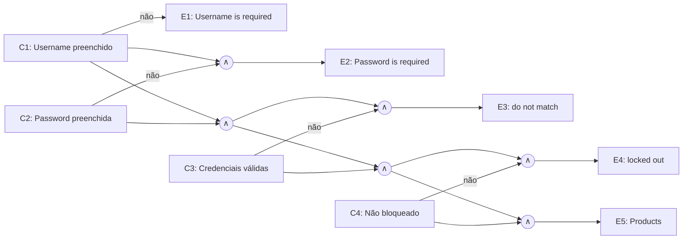
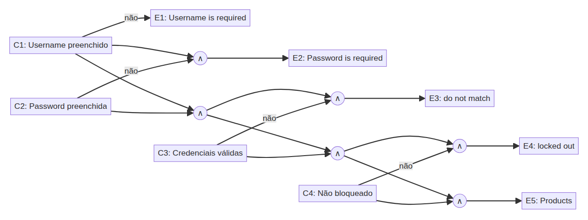

# US001 — Realizar login *(exemplo do template — não conta no mínimo)*

> **Este arquivo é o modelo.** A US001 não conta no mínimo do trabalho; serve para mostrar o nível de detalhe esperado em cada US: técnica aplicada → classes/limites → casos de teste → execução manual e automatizada.

- **Responsável:** Luis Felipe Holanda Martins
- **Especificação:** [Parte 1 — US001](../01-especificacao-parte1.md#us001--realizar-login)
- **Automação:** [`cypress/e2e/US001-login.cy.js`](../../cypress/e2e/US001-login.cy.js)

## 1. Condições de entrada

| Condição | Origem |
|---|---|
| Username: preenchido ou vazio | RN01, Campos obrigatórios |
| Password: preenchida ou vazia | RN02, Campos obrigatórios |
| Combinação Username/Password corresponde a um usuário cadastrado | RN03 |
| Usuário bloqueado ou não | RN04 |

## 2. Classes de equivalência

| Caso de Teste | Condição de Entrada | Classes Válidas | Classes Inválidas |
|---|---|---|---|
| CT-US001-01, 02, 04, 05, 06 | Username (U) | **CV1:** U cadastrado e não bloqueado (`standard_user`) | **CI1:** U vazio · **CI2:** U não cadastrado (`standard_use`) · **CI3:** U cadastrado e bloqueado (`locked_out_user`) |
| CT-US001-01, 03, 07, 08 | Password (P) | **CV2:** P correta para U (`secret_sauce`) | **CI4:** P vazia · **CI5:** P incorreta (`secret_sauc`) |

## 3. Análise de valor-limite

O Username/Password válido é uma **string exata**: qualquer caractere a menos ou a mais deve ser recusado. O limite inferior de tamanho é 0 (campo vazio → mensagem de obrigatoriedade).

| Caso de Teste | Condição de Entrada | V.I. −1 (inválido) | V.I. | V.I. +1 | V.S. −1 (inválido) | V.S. (válido) | V.S. +1 (inválido) |
|---|---|---|---|---|---|---|---|
| CT-US001-02, 05, 06 | Tamanho do Username (13 = `standard_user`) | — | 0 → “Username is required” | 1 (`s`) → não corresponde | 12 (`standard_use`) | 13 (`standard_user`) | 14 (`standard_user1`) |
| CT-US001-03, 07, 08 | Tamanho da Password (12 = `secret_sauce`) | — | 0 → “Password is required” | 1 (`s`) → não corresponde | 11 (`secret_sauc`) | 12 (`secret_sauce`) | 13 (`secret_sauce1`) |

## 4. Grafo de causa e efeito

**Causas:** C1 – Username preenchido · C2 – Password preenchida · C3 – Credenciais correspondem a um usuário · C4 – Usuário não bloqueado
**Efeitos:** E1 – “Username is required” · E2 – “Password is required” · E3 – “Username and password do not match…” · E4 – “Sorry, this user has been locked out.” · E5 – Redireciona para “Products”

*Figura (US001) 1: Grafo de causa e efeito – US001 (∧ = E lógico).*

| Regra | C1 | C2 | C3 | C4 | Efeito | CT |
|---|---|---|---|---|---|---|
| R1 | F | – | – | – | E1 | CT-US001-02 |
| R2 | V | F | – | – | E2 | CT-US001-03 |
| R3 | V | V | F | – | E3 | CT-US001-05 a 08 |
| R4 | V | V | V | F | E4 | CT-US001-04 |
| R5 | V | V | V | V | E5 | CT-US001-01 |

Observação da execução: `locked_out_user` com senha **errada** recebe E3 (não E4) — o sistema verifica a credencial antes do bloqueio, o que confirma a ordem C3 → C4 da tabela.

## 5. Casos de teste

| ID | Tipo | Descrição | Entradas | Resultado esperado | Cobre |
|---|---|---|---|---|---|
| CT-US001-01 | Automatizado | Login com credenciais válidas | `standard_user` / `secret_sauce` | Redireciona para `/inventory.html`, título “Products” | CV1, CV2, R5 |
| CT-US001-02 | Automatizado | Username vazio | `""` / `secret_sauce` | “Epic sadface: Username is required” | CI1, VL 0, R1, RN01 |
| CT-US001-03 | Automatizado | Password vazia | `standard_user` / `""` | “Epic sadface: Password is required” | CI4, VL 0, R2, RN02 |
| CT-US001-04 | Automatizado | Usuário bloqueado | `locked_out_user` / `secret_sauce` | “Epic sadface: Sorry, this user has been locked out.” | CI3, R4, RN04 |
| CT-US001-05 | Automatizado | Username com 1 caractere a menos | `standard_use` / `secret_sauce` | “…do not match any user in this service” | CI2, VS −1, R3 |
| CT-US001-06 | Automatizado | Username com 1 caractere a mais | `standard_user1` / `secret_sauce` | “…do not match any user in this service” | CI2, VS +1, R3 |
| CT-US001-07 | Automatizado | Password com 1 caractere a menos | `standard_user` / `secret_sauc` | “…do not match any user in this service” | CI5, VS −1, R3 |
| CT-US001-08 | Automatizado | Password com 1 caractere a mais | `standard_user` / `secret_sauce1` | “…do not match any user in this service” | CI5, VS +1, R3 |
| CT-US001-09 | Manual | Fechar a mensagem de erro pelo “X” | `""` / `""` → clicar “X” | Mensagem some; campos voltam ao estado normal | Critério de aceite 5 |
| CT-US001-10 | Manual | Username com 1 caractere | `s` / `secret_sauce` | “…do not match any user in this service” | CI2, VI +1, R3 |
| CT-US001-11 | Manual | Bloqueado com senha errada | `locked_out_user` / `x` | “…do not match any user in this service” | CI3 + CI5, R3 |

## 6. Registro de execução — testes manuais

| ID | Funcionalidade | Descrição | Entradas | Valor da Entrada | Resultado esperado | Resultado do Testador 1 (Luis) |
|---|---|---|---|---|---|---|
| CT-US001-09 | Login | Fechar mensagem de erro | Username / Password | `""` / `""` + clique no “X” | Mensagem de erro some | Data da Execução: 07/11/2026. Passou |
| CT-US001-10 | Login | Username com 1 caractere | Username / Password | `s` / `secret_sauce` | “…do not match any user in this service” | Data da Execução: 07/11/2026. Passou |
| CT-US001-11 | Login | Bloqueado com senha errada | Username / Password | `locked_out_user` / `x` | “…do not match any user in this service” | Data da Execução: 07/11/2026. Passou |

## 7. Registro de execução — testes automatizados

| ID | Resultado | Data |
|---|---|---|
| CT-US001-01 a CT-US001-08 | 8/8 passaram (`npm test -- --spec cypress/e2e/US001-login.cy.js`) | 07/11/2026 |

## 8. Observações

- Os CTs 05–08 vêm direto da tabela de valor-limite e foram automatizados de forma *data-driven* (um array com as linhas da tabela + `forEach`), sem repetir código.
