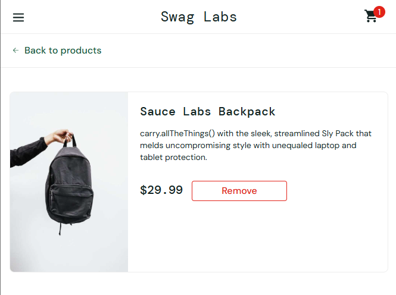
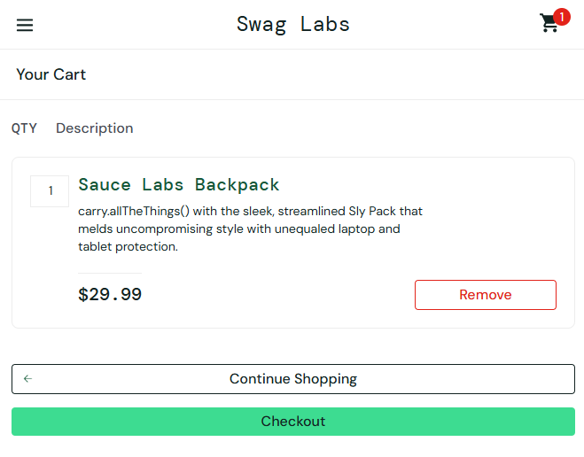
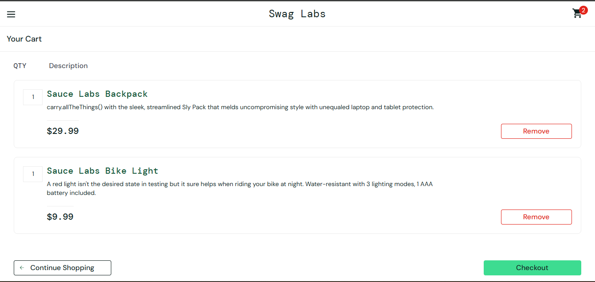
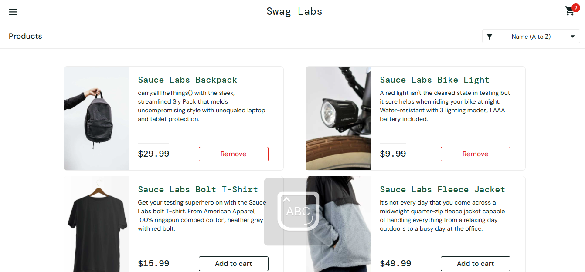
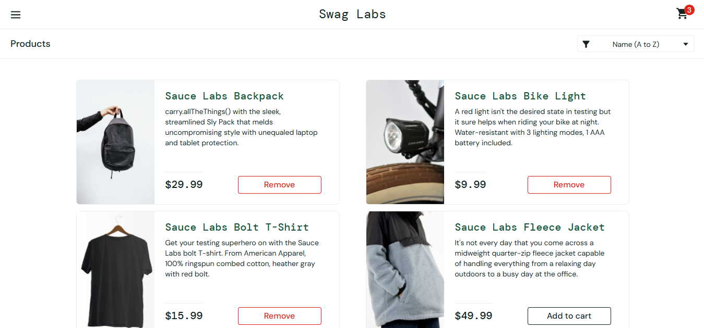
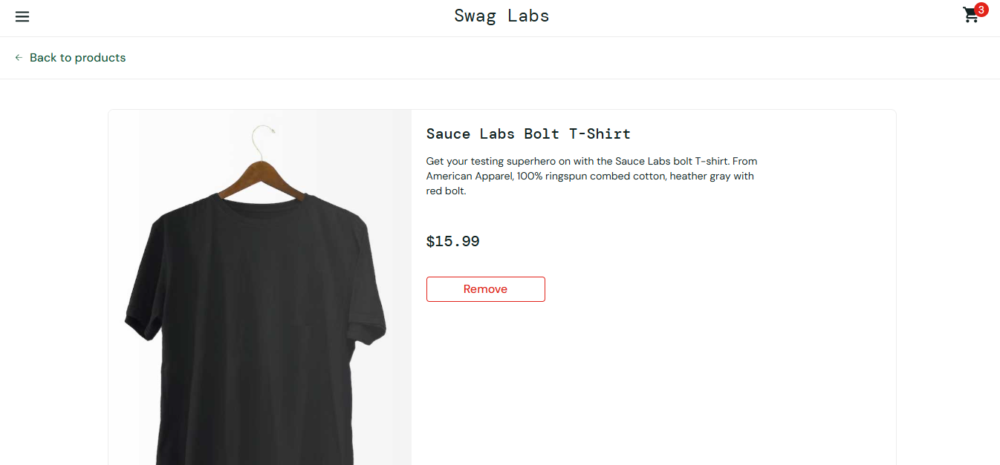

# US003 — Adicionar produto ao carrinho

- **Responsável:** Samira Kelvia Oliveira De Sousa
- **Especificação:** [Parte 1 — US003](../01-especificacao-parte1.md#us003--adicionar-produto-ao-carrinho)
- **Automação:** [`cypress/e2e/US003-adicionar-carrinho.cy.js`](../../cypress/e2e/US003-adicionar-carrinho.cy.js)
- **Casos de teste:** 6 (3 manuais + 3 automatizados) · **Incidentes:** nenhum (3 manuais e 3 automatizados passaram)

## 1. Condições de entrada

| Condição | Origem |
|---|---|
| Estado do produto: fora do carrinho (botão “Add to cart”) ou já no carrinho (botão “Remove”) | Entradas e pré-condições, RN01 |
| Origem da adição: página “Products” (listagem) ou página de detalhes | Descrição, CE001, CE002, RN04 |
| Número de itens no carrinho antes de adicionar (0 a 6) | RN01, RN03 |
| Navegação entre listagem, detalhes e carrinho depois de adicionar | RN05 |

## 2. Classes de equivalência

| Caso de Teste | Condição de Entrada | Classes Válidas | Classes Inválidas |
|---|---|---|---|
| CT-US003-01, 02, 03, 05, 06 | Estado do produto | **CV1:** produto fora do carrinho (botão “Add to cart”) | **CI1:** produto já no carrinho (não há botão “Add to cart” nem campo de quantidade) — CT-US003-04 |
| CT-US003-01, 03, 05 | Origem da adição | **CV2:** listagem (“Products”) | — (a interface não oferece outra origem inválida) |
| CT-US003-02, 06 | Origem da adição | **CV3:** página de detalhes | — |
| CT-US003-01, 02, 03, 05, 06 | Itens no carrinho antes de adicionar (Q) | **CV4:** 0 ≤ Q ≤ 5 (ainda existe produto disponível) | **CI2:** Q = 6 (todos os produtos já adicionados; nenhum botão “Add to cart” restante) — CT-US003-03 |

## 3. Análise de valor-limite

O catálogo tem 6 produtos e a QTY é sempre 1 (RN01), então o número de itens do carrinho vai de 0 a 6.

| Caso de Teste | Condição de Entrada | V.I. −1 (inválido) | V.I. | V.I. +1 (válido) | V.S. −1 (válido) | V.S. | V.S. +1 (inválido) |
|---|---|---|---|---|---|---|---|
| CT-US003-01, 03 | Itens no carrinho (N) após a adição | −1 → impossível (a interface não permite) | 0 → contador oculto (RN03) | 1 → contador “1” | 5 → contador “5” | 6 → contador “6”, sem botão “Add to cart” | 7 → impossível (não existe 7º produto) |

Valores impossíveis pela interface ficam na tabela com a justificativa; o que se verifica é que a interface realmente não oferece como chegar a eles.

## 4. Grafo de causa e efeito

**Não aplicável.** A adição depende de uma única condição (o produto estar fora do carrinho) e o efeito é o mesmo na listagem e nos detalhes (botão “Remove”, contador +1, item listado). Não há combinação de condições gerando efeitos diferentes, então o grafo não se aplica.

## 5. Casos de teste

Pré-condição comum: usuário logado (`standard_user`), carrinho vazio, salvo indicação contrária.

| ID | Tipo | Descrição | Pré-condição | Entradas | Resultado esperado | Cobre |
|---|---|---|---|---|---|---|
| CT-US003-01 | Automatizado | Adicionar pela listagem com o carrinho vazio | Na página “Products” | “Add to cart” em “Sauce Labs Backpack” | Botão vira “Remove”; contador “1”; “Your Cart” lista “Sauce Labs Backpack” com QTY 1 e $29.99 | CV1, CV2, CV4, VL 0→1, RN01, RN03, CE001 |
| CT-US003-02 | Automatizado | Adicionar pela página de detalhes | Na página de detalhes de “Sauce Labs Backpack” | “Add to cart”; depois “Back to products” | Botão “Remove” e contador “1” nos detalhes; ao voltar, “Remove” e contador “1” na listagem | CV1, CV3, RN03, RN04, CE002 |
| CT-US003-03 | Automatizado | Adicionar os 6 produtos, um a um | Na página “Products” | “Add to cart” nos 6 produtos em sequência | Contador 1, 2, 3, 4, 5, 6 a cada adição; nenhum botão “Add to cart” sobra; “Your Cart” lista 6 itens | CV4, CI2, VL 1, 5, 6, RN01, RN03 |
| CT-US003-04 | Manual | Tentar adicionar uma segunda unidade do mesmo produto | “Sauce Labs Backpack” já no carrinho | Procurar “Add to cart” ou campo de quantidade na listagem, nos detalhes e em “Your Cart” | Nenhum dos três oferece “Add to cart” nem campo de QTY; contador e QTY continuam 1 | CI1, RN01, CE003 |
| CT-US003-05 | Manual | Itens permanecem ao navegar entre as páginas | Na página “Products” | Adicionar “Sauce Labs Backpack” e “Sauce Labs Bike Light”; ir a detalhes, voltar, abrir “Your Cart”, clicar “Continue Shopping” | Os 2 itens e o contador “2” permanecem em todas as páginas | CV1, CV2, RN05 |
| CT-US003-06 | Manual | Estado do botão acompanha a adição feita na listagem | Na página “Products” | Adicionar “Sauce Labs Bolt T-Shirt” pela listagem; abrir os detalhes dele | Detalhes exibem “Remove” (e não “Add to cart”); contador “1” | CV1, CV2, RN04 |

## 6. Registro de execução — testes manuais

| ID | Funcionalidade | Descrição | Entradas | Valor da Entrada | Resultado esperado | Resultado do Testador 1 (Samira) | Resultado do Testador 2 (<nome>) |
|---|---|---|---|---|---|---|---|
| CT-US003-04 | Carrinho | Segunda unidade do mesmo produto | Produto já no carrinho | “Sauce Labs Backpack” | Sem “Add to cart” nem campo de QTY; contador e QTY = 1 | Data da Execução: 08/11/2026. Passou — nos detalhes o botão segue “Remove” e não há campo de quantidade (Figura (US003) 1); em “Your Cart” a QTY não pode ser alterada (Figura (US003) 2) | |
| CT-US003-05 | Carrinho | Itens permanecem ao navegar | Produtos / navegação | Backpack + Bike Light | 2 itens e contador “2” em todas as páginas | Data da Execução: 08/11/2026. Passou — “Your Cart” com os 2 itens (Figura (US003) 3); após “Continue Shopping” os 2 continuam com “Remove” e contador “2” (Figura (US003) 4) | |
| CT-US003-06 | Carrinho | Botão acompanha a adição da listagem | Produto / página | Bolt T-Shirt | Detalhes exibem “Remove”; contador “1” | Data da Execução: 08/11/2026. Passou — Bolt T-Shirt adicionado pela listagem (Figura (US003) 5); nos detalhes o botão é “Remove” (Figura (US003) 6). Nesta execução o carrinho já tinha 2 itens, então o contador mostrou “3” | |

*Figura (US003) 1: Detalhes do “Sauce Labs Backpack” já no carrinho: botão “Remove”, sem campo de quantidade (CT-US003-04).*

*Figura (US003) 2: “Your Cart” com o Backpack: QTY 1, sem possibilidade de alterar (CT-US003-04).*

*Figura (US003) 3: “Your Cart” com Backpack e Bike Light e contador “2” (CT-US003-05).*

*Figura (US003) 4: Listagem após “Continue Shopping”: os 2 itens com “Remove” e contador “2” (CT-US003-05).*

*Figura (US003) 5: Listagem com o “Sauce Labs Bolt T-Shirt” adicionado e contador “3” (CT-US003-06).*

*Figura (US003) 6: Detalhes do “Sauce Labs Bolt T-Shirt” com botão “Remove” e contador “3” (CT-US003-06).*

## 7. Registro de execução — testes automatizados

| ID | Teste no Cypress | Resultado | Data |
|---|---|---|---|
| CT-US003-01 | `it('CT-US003-01 \| adicionar pela listagem ...')` | Passou | 08/11/2026 |
| CT-US003-02 | `it('CT-US003-02 \| adicionar pela página de detalhes ...')` | Passou | 08/11/2026 |
| CT-US003-03 | `it('CT-US003-03 \| adicionar os 6 produtos ...')` | Passou | 08/11/2026 |

## 8. Observações

- **Incidentes:** nenhum defeito encontrado na US003.
- O CT-US003-06 foi executado com 2 itens já no carrinho; por isso o contador mostrou “3” e não “1”. O que o caso verifica (botão “Remove” nos detalhes) foi confirmado.

Comando: `npm test -- --spec "cypress/e2e/US003*"` → 3 passing (Cypress 15.21.1, Electron 138). Vídeo em `cypress/videos/`.

- A US003 não tem classe inválida de digitação: a QTY é fixa em 1 (RN01), então não existem quantidades 0, negativas ou decimais para testar.
- Sugestão de exploração (não conta como CT): repetir o CT-US003-01 com `problem_user`, que tem defeitos propositais, e registrar qualquer diferença como incidente.
