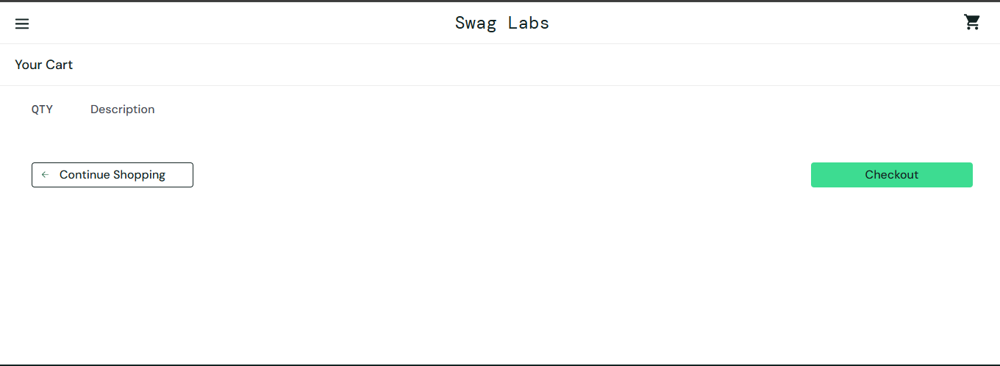
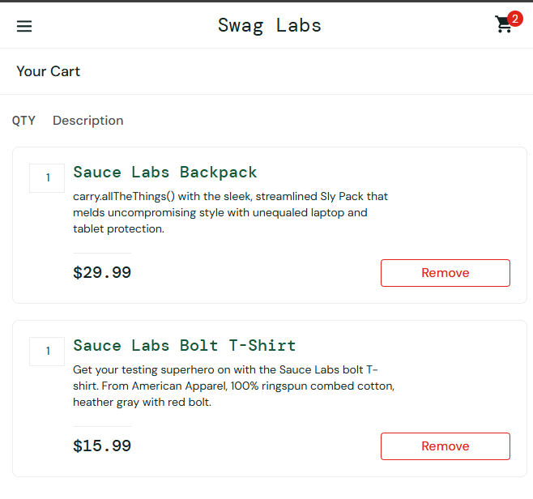
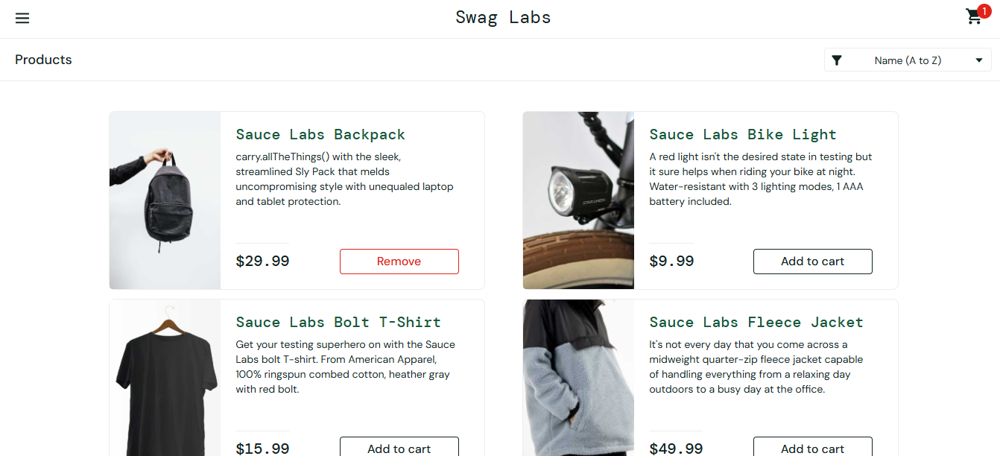
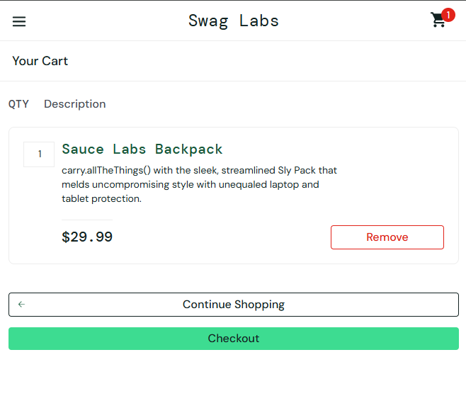

# US004 — Remover produto do carrinho

- **Responsável:** Samira Kelvia Oliveira De Sousa
- **Especificação:** [Parte 1 — US004](../01-especificacao-parte1.md#us004--remover-produto-do-carrinho)
- **Automação:** [`cypress/e2e/US004-remover-carrinho.cy.js`](../../cypress/e2e/US004-remover-carrinho.cy.js)
- **Casos de teste:** 6 (3 manuais + 3 automatizados) · **Incidentes:** nenhum (3 manuais e 3 automatizados passaram)
- **Relação com a US003:** os produtos que serão removidos são adicionados pelo fluxo da US003; se a adição falhar, os testes da US004 também falham.

## 1. Condições de entrada

| Condição | Origem |
|---|---|
| Número de itens no carrinho antes de remover (0 a 6) | Entradas e pré-condições, RN03, RN04 |
| Item clicado em “Remove” na página “Your Cart” | Descrição, RN02, RN03 |
| Estado do botão do produto removido na página “Products” | Saídas, RN05 |
| Confirmação antes de remover (existe ou não) | RN01 |

## 2. Classes de equivalência

| Caso de Teste | Condição de Entrada | Classes Válidas | Classes Inválidas |
|---|---|---|---|
| CT-US004-01, 03, 05 | Itens no carrinho antes de remover (N) | **CV1:** N ≥ 2 (após remover ainda sobram itens) | **CI1:** N = 0 (carrinho vazio; não há botão “Remove”) — CT-US004-04 |
| CT-US004-02, 03, 06 | Itens no carrinho antes de remover (N) | **CV2:** N = 1 (remove o último item) | — |
| CT-US004-01, 05 | Item clicado em “Remove” | **CV3:** item presente em “Your Cart” (botão “Remove” visível) | — (a interface só oferece “Remove” para itens presentes) |
| CT-US004-02, 05, 06 | Estado do produto removido em “Products” | **CV4:** produto volta a exibir “Add to cart” | — |

## 3. Análise de valor-limite

O carrinho tem de 0 a 6 itens (6 produtos no catálogo, QTY sempre 1).

| Caso de Teste | Condição de Entrada | V.I. −1 (inválido) | V.I. | V.I. +1 (válido) | V.S. −1 (válido) | V.S. | V.S. +1 (inválido) |
|---|---|---|---|---|---|---|---|
| CT-US004-01, 02, 03, 04 | Itens no carrinho antes de remover (N) | 0 → sem botão “Remove” (nada a remover) | 1 → após remover, carrinho vazio e contador oculto | 2 → contador “1” | 5 → contador “4” | 6 → contador “5” | 7 → impossível (só existem 6 produtos) |

## 4. Grafo de causa e efeito

**Não aplicável.** A remoção depende de uma única condição (o item estar no carrinho) e sempre retira o item inteiro (QTY = 1, RN02). O contador oculto com o carrinho vazio é consequência dessa mesma condição, não uma combinação de causas com efeitos diferentes.

## 5. Casos de teste

Pré-condição comum: usuário logado (`standard_user`); os produtos são adicionados pela listagem (US003) e depois se abre “Your Cart”.

| ID | Tipo | Descrição | Pré-condição | Entradas | Resultado esperado | Cobre |
|---|---|---|---|---|---|---|
| CT-US004-01 | Automatizado | Remover 1 de 2 itens | “Sauce Labs Backpack” e “Sauce Labs Bike Light” no carrinho (contador “2”) | “Remove” em “Sauce Labs Bike Light” | Bike Light deixa de ser listado; contador “1”; Backpack continua com QTY 1 | CV1, CV3, VL 2→1, RN02, RN03, RN04, CE001 |
| CT-US004-02 | Automatizado | Remover o último item e voltar à listagem | Só o Backpack no carrinho | “Remove” → “Continue Shopping” | Lista vazia; contador oculto; na listagem o Backpack volta com “Add to cart” | CV2, CV4, VL 1→0, RN04, RN05, CE002 |
| CT-US004-03 | Automatizado | Remover os 6 itens, um a um | 6 produtos no carrinho | “Remove” sempre no 1º item da lista | Contador 5, 4, 3, 2, 1 e depois oculto; “Your Cart” sem itens | CV1, CV2, VL 6→5, 1→0, RN03, RN04 |
| CT-US004-04 | Manual | Abrir “Your Cart” com o carrinho vazio | Carrinho vazio | Clicar no ícone do carrinho | Página sem itens e sem botão “Remove”; sem contador; “Continue Shopping” volta ao catálogo | CI1, VL 0, CE003 |
| CT-US004-05 | Manual | Remoção é imediata e o botão em “Products” acompanha | Backpack e Bolt T-Shirt no carrinho | “Remove” em Bolt T-Shirt → “Continue Shopping” | Sem janela de confirmação; o item some na hora; na listagem Bolt T-Shirt volta a “Add to cart” e Backpack segue “Remove” | CV1, CV3, CV4, RN01, RN03, RN05 |
| CT-US004-06 | Manual | Produto removido pode ser adicionado de novo (complementa a US003) | Carrinho vazio | Adicionar Backpack; “Remove” em “Your Cart”; voltar e adicionar de novo | Contador “1”; “Your Cart” lista o Backpack uma única vez, com QTY 1 | CV2, CV4, RN02, US003 RN01 |

## 6. Registro de execução — testes manuais

| ID | Funcionalidade | Descrição | Entradas | Valor da Entrada | Resultado esperado | Resultado do Testador 1 (Samira) | Resultado do Testador 2 (<nome>) |
|---|---|---|---|---|---|---|---|
| CT-US004-04 | Carrinho | Carrinho vazio | Itens | 0 | Sem itens, sem “Remove” e sem contador | Data da Execução: 09/11/2026. Passou — “Your Cart” sem itens, sem “Remove” e sem contador (Figura (US004) 1); ao clicar em “Continue Shopping” volta ao catálogo (“Products”) | |
| CT-US004-05 | Carrinho | Remoção imediata e botão em “Products” | Itens / ação | Backpack + Bolt T-Shirt; remover Bolt | Sem confirmação; Bolt volta a “Add to cart” | Data da Execução: 09/11/2026. Passou — com 2 itens (Figura (US004) 2), “Remove” no Bolt o retira na hora, sem janela ou mensagem (Figura (US004) 3); na listagem Bolt volta a “Add to cart”, Backpack segue “Remove” e o contador vai a “1” (Figura (US004) 4) | |
| CT-US004-06 | Carrinho | Remover e adicionar de novo | Produto / ações | Backpack: adicionar, remover, adicionar | Contador “1”; item listado uma vez, QTY 1 | Data da Execução: 09/11/2026. Passou — após remover o carrinho fica vazio (Figura (US004) 6); ao adicionar de novo o Backpack aparece uma única vez, QTY 1 e contador “1” (Figura (US004) 5) | |

*Figura (US004) 1: “Your Cart” com o carrinho vazio: sem itens, sem “Remove” e sem contador (CT-US004-04).*

*Figura (US004) 2: “Your Cart” com Backpack e Bolt T-Shirt, contador “2”, antes de remover (CT-US004-05).*

*Figura (US004) 3: “Your Cart” logo após “Remove” no Bolt T-Shirt: item removido sem confirmação e contador “1” (CT-US004-05).*

*Figura (US004) 4: Listagem com o Bolt T-Shirt de volta a “Add to cart”, Backpack com “Remove” e contador “1” (CT-US004-05).*

*Figura (US004) 5: Backpack adicionado de novo: aparece uma única vez, QTY 1, contador “1” (CT-US004-06).*

*Figura (US004) 6: “Your Cart” vazio depois de remover o Backpack (CT-US004-06).*

## 7. Registro de execução — testes automatizados

| ID | Teste no Cypress | Resultado | Data |
|---|---|---|---|
| CT-US004-01 | `it('CT-US004-01 \| remover 1 de 2 itens ...')` | Passou | 08/11/2026 |
| CT-US004-02 | `it('CT-US004-02 \| remover o último item ...')` | Passou | 08/11/2026 |
| CT-US004-03 | `it('CT-US004-03 \| remover os 6 itens ...')` | Passou | 08/11/2026 |

## 8. Observações

- **Incidentes:** nenhum defeito encontrado na US004.

- **Incidentes:** nenhum defeito encontrado na US004.

Comando: `npm test -- --spec "cypress/e2e/US004*"` → 3 passing (Cypress 15.21.1, Electron 138). Vídeo em `cypress/videos/US004-remover-carrinho.cy.js.mp4`.

- A US004 não tem classe inválida de digitação: não há campos. A única classe inválida é o carrinho vazio.
- O botão “Remove” também existe na listagem (“Products”). Isso não está na especificação da US004, que trata da remoção em “Your Cart”, então não virou caso de teste; fica como sugestão de exploração.
