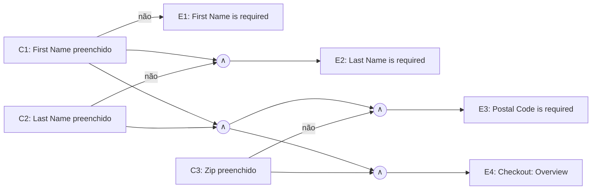
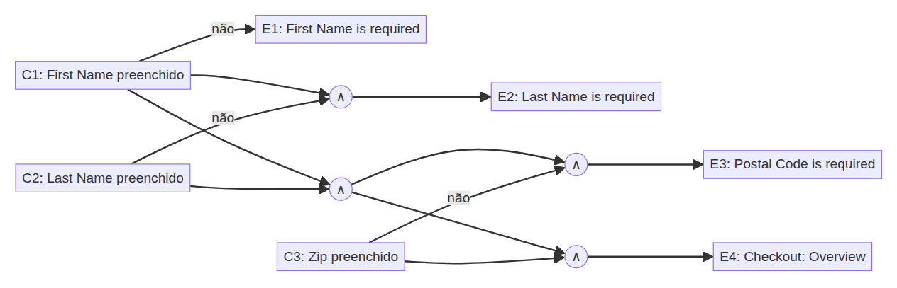
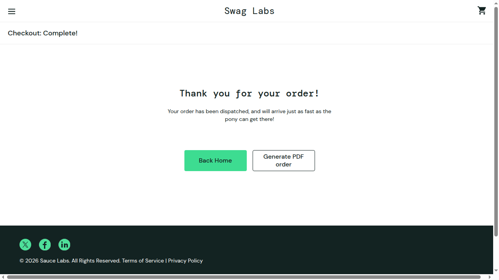

# US005 — Finalizar compra (checkout)

- **Responsável:** Luis Felipe Holanda Martins
- **Especificação:** [Parte 1 — US005](../01-especificacao-parte1.md#us005--finalizar-compra-checkout)
- **Automação:** [`cypress/e2e/US005-checkout.cy.js`](../../cypress/e2e/US005-checkout.cy.js)
- **Casos de teste:** 5 (3 manuais + 2 automatizados) · **Incidentes:** 1 ([INC-01](../04-incidentes.md#inc-01--checkout-é-concluído-com-o-carrinho-vazio))

## 1. Condições de entrada

| Condição | Origem |
|---|---|
| First Name: preenchido ou vazio | Campos obrigatórios, RN01 |
| Last Name: preenchido ou vazio | Campos obrigatórios, RN01 |
| Zip/Postal Code: preenchido ou vazio | Campos obrigatórios, RN01, RN06 |
| Quantidade de itens no carrinho ao iniciar o checkout (0 a 6) | RN02, RN03 |
| Valores dos itens (Item total → Tax de 8% → Total) | RN03, RN04, RN05 |

## 2. Classes de equivalência

| Caso de Teste | Condição de Entrada | Classes Válidas | Classes Inválidas |
|---|---|---|---|
| CT-US005-01, 02, 03 | First Name (FN) | **CV1:** FN preenchido (ex.: `Maria`) | **CI1:** FN vazio |
| CT-US005-01, 02, 03 | Last Name (LN) | **CV2:** LN preenchido (ex.: `Silva`) | **CI2:** LN vazio |
| CT-US005-01, 02, 03 | Zip/Postal Code (Z) | **CV3:** Z preenchido (ex.: `62900-000`) | **CI3:** Z vazio |
| CT-US005-01, 04, 05 | Itens no carrinho (Q) | **CV4:** 1 ≤ Q ≤ 6 | **CI4:** Q = 0 (carrinho vazio) |

## 3. Análise de valor-limite

A especificação não define tamanho máximo para os campos, então o limite analisado é o **mínimo** (0 × 1 caractere). Para o carrinho, o mínimo é 1 item e o máximo é 6 (todos os produtos do catálogo, já que a QTY é sempre 1 — US003 RN01).

| Caso de Teste | Condição de Entrada | V.I. −1 (inválido) | V.I. | V.I. +1 (válido) | V.S. −1 (válido) | V.S. | V.S. +1 (inválido) |
|---|---|---|---|---|---|---|---|
| CT-US005-02, 03 | Tamanho de FN, LN e Z (caracteres) | 0 → mensagem de obrigatório | 1 → avança | 2 → avança | — (sem máximo definido) | — | — |
| CT-US005-01, 04, 05 | Itens no carrinho (Q) | 0 → não deve permitir checkout | 1 | 2 | 5 | 6 | 7 → impossível (só 6 produtos) |
| CT-US005-01, 04 | Tax = 8% do Item total, arredondado a 2 casas | — | 1 item: $29.99 → Tax $2.40 (2,3992) | — | — | 6 itens: $129.94 → Tax $10.40 (10,3952) | — |

## 4. Grafo de causa e efeito

**Causas:** C1 – First Name preenchido · C2 – Last Name preenchido · C3 – Zip/Postal Code preenchido
**Efeitos:** E1 – “Error: First Name is required” · E2 – “Error: Last Name is required” · E3 – “Error: Postal Code is required” · E4 – Avança para “Checkout: Overview”

Como os campos são validados em ordem (RN01), só a primeira causa falsa gera efeito.

*Figura (US005) 1: Grafo de causa e efeito – US005 (∧ = E lógico).*

| Regra | C1 | C2 | C3 | Efeito | Caso de Teste |
|---|---|---|---|---|---|
| R1 | F | – | – | E1 | CT-US005-02 (R1) |
| R2 | V | F | – | E2 | CT-US005-02 (R2) |
| R3 | V | V | F | E3 | CT-US005-02 (R3) |
| R4 | V | V | V | E4 | CT-US005-01, CT-US005-03 |

## 5. Casos de teste

| ID | Tipo | Descrição | Pré-condição | Entradas | Resultado esperado | Cobre |
|---|---|---|---|---|---|---|
| CT-US005-01 | Automatizado | Compra com 1 item calcula valores e conclui o pedido | Logado; “Sauce Labs Backpack” no carrinho | FN `Maria`, LN `Silva`, Z `62900-000` → Continue → Finish | Overview: Item total $29.99, Tax $2.40, Total $32.39; após Finish: “Thank you for your order!” e contador some | CV1–CV4, R4, VL 1 item, RN03–RN05, RN07, CE001 |
| CT-US005-02 | Automatizado | Campos obrigatórios validados na ordem (tabela de decisão R1–R3) | Logado; 1 item no carrinho; tela “Checkout: Your Information” | R1: FN vazio · R1: todos vazios · R2: LN vazio · R3: Z vazio | Mensagem do 1º campo vazio (“Error: First Name/Last Name/Postal Code is required”) e permanece na tela | CI1–CI3, VL 0, R1–R3, RN01, CE002, CE003 |
| CT-US005-03 | Manual | Campos com 1 caractere são aceitos | Logado; 1 item no carrinho; tela “Checkout: Your Information” | FN `A`, LN `B`, Z `1` | Avança para “Checkout: Overview” | CV1–CV3, VL 1 caractere, R4 |
| CT-US005-04 | Manual | Checkout com os 6 produtos (máximo) calcula valores corretamente | Logado; 6 produtos no carrinho | FN `Maria`, LN `Silva`, Z `62900-000` | Item total $129.94, Tax $10.40, Total $140.34 | CV4, VL 6 itens, RN03–RN05 |
| CT-US005-05 | Manual | Tentar fazer checkout com o carrinho vazio | Logado; carrinho vazio; página “Your Cart” | Clicar “Checkout” → FN `Maria`, LN `Silva`, Z `62900-000` → Continue → Finish | Sistema **não** permite iniciar o checkout (RN02) | CI4, VL 0 itens, RN02 |

## 6. Registro de execução — testes manuais

| ID | Funcionalidade | Descrição | Entradas | Valor da Entrada | Resultado esperado | Resultado do Testador 1 (Luis) |
|---|---|---|---|---|---|---|
| CT-US005-03 | Checkout | Campos com 1 caractere | First Name / Last Name / Zip | `A` / `B` / `1` | Avança para “Checkout: Overview” | Data da Execução: 07/11/2026. Passou |
| CT-US005-04 | Checkout | 6 produtos no carrinho | Itens / First Name / Last Name / Zip | 6 produtos / `Maria` / `Silva` / `62900-000` | Item total $129.94, Tax $10.40, Total $140.34 | Data da Execução: 07/11/2026. Passou |
| CT-US005-05 | Checkout | Checkout com carrinho vazio | Itens / First Name / Last Name / Zip | 0 / `Maria` / `Silva` / `62900-000` | Não permitir iniciar o checkout | Data da Execução: 07/11/2026. **Falhou** — o botão “Checkout” fica habilitado, o Overview mostra Item total $0 / Total $0.00 e o pedido é concluído com “Thank you for your order!”. Ver [INC-01](../04-incidentes.md#inc-01--checkout-é-concluído-com-o-carrinho-vazio) e Figura (US005) 2 |

*Figura (US005) 2: Tela “Checkout: Complete!” após finalizar um pedido com o carrinho vazio (CT-US005-05).*

## 7. Registro de execução — testes automatizados

| ID | Teste no Cypress | Resultado | Data |
|---|---|---|---|
| CT-US005-01 | `it('CT-US005-01 \| compra com 1 item calcula Tax de 8%...')` | Passou | 07/11/2026 |
| CT-US005-02 | `it('CT-US005-02 (R1/R2/R3) \| ...')` — 4 execuções, uma por linha da tabela de decisão | Passou (4/4) | 07/11/2026 |

Comando: `npm test -- --spec cypress/e2e/US005-checkout.cy.js` → 5 passing.

## 8. Observações

- **Defeito encontrado (INC-01):** a RN02 não é respeitada. Não existe validação de carrinho vazio no checkout.
- **Candidato a novo CT:** campos preenchidos só com espaços (`"   "`) também são aceitos e o checkout avança. Pela especificação, um campo só com espaços deveria ser tratado como vazio (classe inválida extra). Fica como sugestão para quem quiser explorar.
- Detalhe visual: com o carrinho vazio, o Overview mostra “Item total: $0” (sem casas decimais), diferente de “Tax: $0.00”.
- O CT-US005-02 foi automatizado de forma *data-driven*: cada linha da tabela de decisão vira uma execução do mesmo teste.
