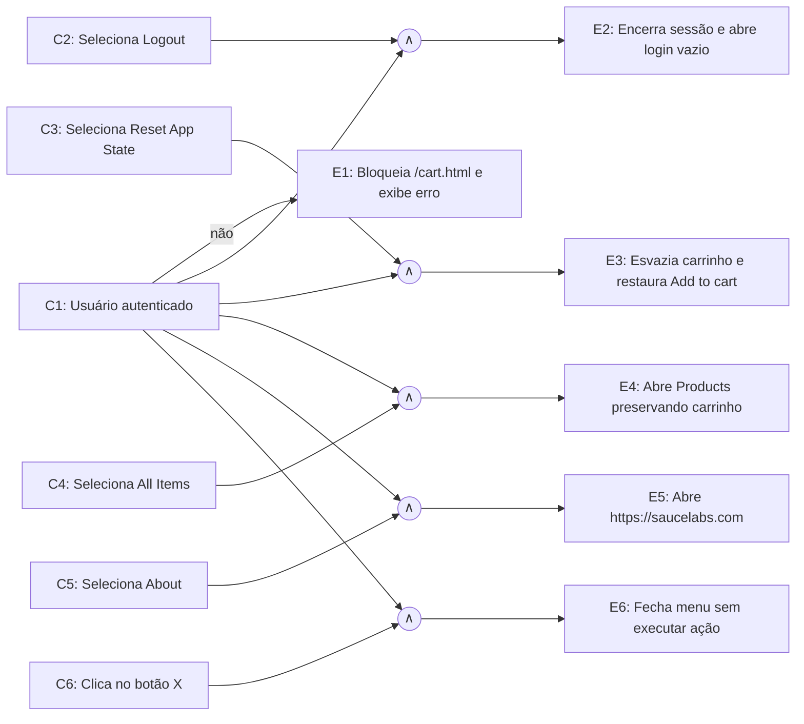
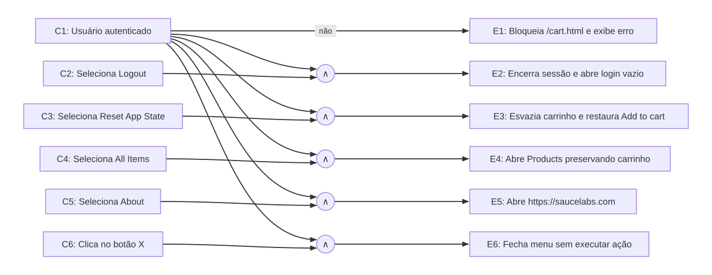
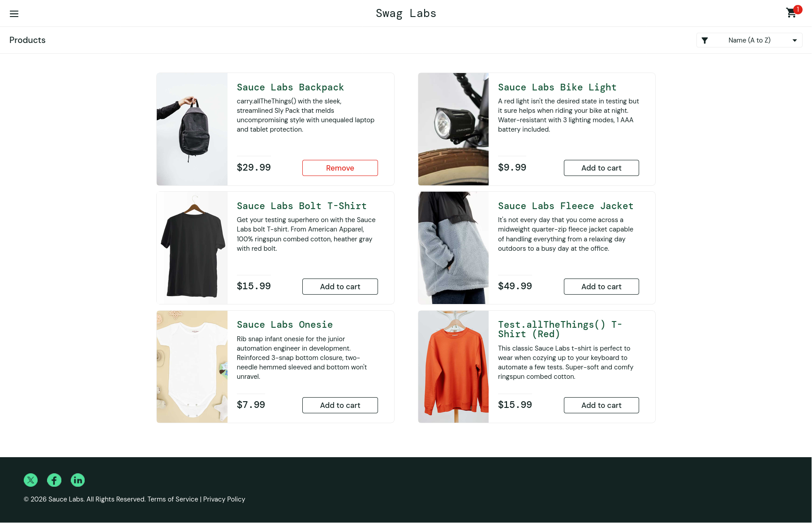
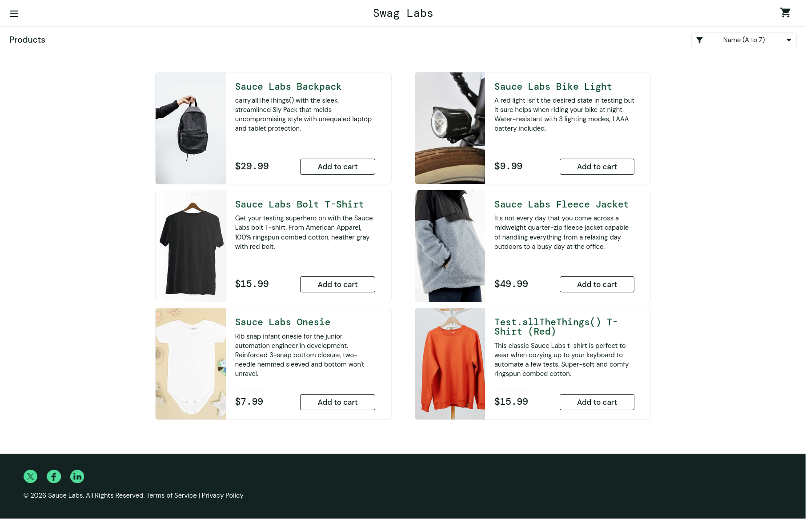
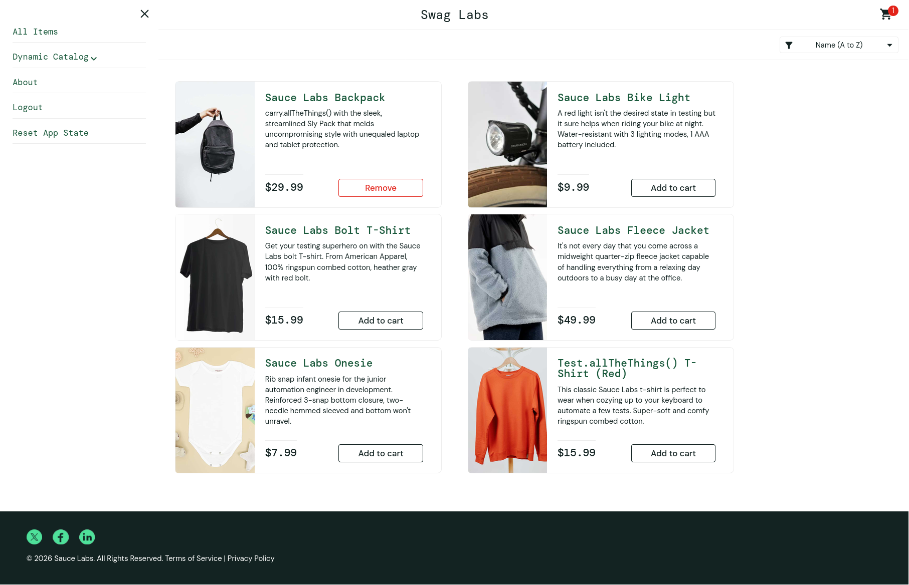
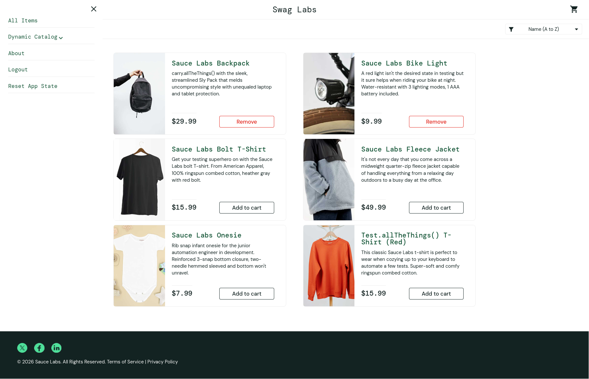

# US006 — Navegar pelo menu lateral

- **Responsável:** Arthur Gomes Menezes
- **Especificação:** [Parte 1 — US006](../01-especificacao-parte1.md#us006--navegar-pelo-menu-lateral)
- **Automação:** [`cypress/e2e/US006-menu-lateral.cy.js`](../../cypress/e2e/US006-menu-lateral.cy.js)
- **Casos de teste:** 7 (5 manuais + 2 automatizados) · **Incidentes:** 1 ([INC-03](../04-incidentes.md#inc-03--botões-remove-não-voltam-para-add-to-cart-após-reset-app-state))

## 1. Condições de entrada

| Condição | Origem |
|---|---|
| Estado de autenticação do usuário: autenticado em uma página interna ou não autenticado após realizar Logout | RN01, RN02, CE003 |
| Ação sobre o menu lateral: abrir pelo ícone ☰, fechar pelo botão “X” ou selecionar uma das opções (“All Items”, “Dynamic Catalog”, “About”, “Logout” ou “Reset App State”) | RN04, RN05, RN06 |
| Quantidade de itens no carrinho antes de acionar “Reset App State” ou “All Items” (de 0 a 6) | RN03, RN04, CE002 |

## 2. Classes de equivalência

| Caso de Teste | Condição de Entrada | Classes Válidas | Classes Inválidas |
|---|---|---|---|
| CT-US006-01, 02, 03, 04, 05, 06, 07 | Estado de autenticação | **CV1:** Usuário autenticado em página interna (ex.: “Products” ou “Your Cart”) | **CI1:** Usuário não autenticado após Logout tentando acessar URL interna (CT-US006-03) |
| CT-US006-01, 02, 04, 05, 06, 07 | Opção / Ação do menu lateral | **CV2:** “All Items” · **CV3:** “About” · **CV4:** “Logout” · **CV5:** “Reset App State” · **CV6:** “Dynamic Catalog” · **CV7:** Fechar menu pelo botão “X” | — |
| CT-US006-02, 04, 05 | Itens no carrinho antes da ação (Q) | **CV8:** Q = 0 (carrinho vazio) · **CV9:** 1 ≤ Q ≤ 6 (carrinho com itens) | — |

## 3. Análise de valor-limite

O catálogo possui 6 produtos (QTY sempre 1 — US003 RN01), portanto a quantidade de itens no carrinho varia entre os limites 0 e 6. Os demais cenários da US006 (seleção das opções de menu e bloqueio pós-logout) envolvem condições discretas ou binárias, não possuindo limites numéricos.

| Caso de Teste | Condição de Entrada | V.I. −1 (inválido) | V.I. | V.I. +1 (válido) | V.S. −1 (válido) | V.S. | V.S. +1 (inválido) |
|---|---|---|---|---|---|---|---|
| CT-US006-02, 05 | Itens no carrinho ao acionar “Reset App State” (N) | −1 → impossível (interface não permite) | 0 → carrinho permanece vazio e contador oculto | 1 → esvazia carrinho, oculta contador e restaura “Add to cart” | 5 → esvazia carrinho, oculta contador e restaura “Add to cart” | 6 → esvazia carrinho, oculta contador e restaura “Add to cart” | 7 → impossível (só existem 6 produtos) |

## 4. Grafo de causa e efeito

**Causas:** C1 – Usuário está autenticado · C2 – Seleciona “Logout” · C3 – Seleciona “Reset App State” · C4 – Seleciona “All Items” · C5 – Seleciona “About” · C6 – Clica no botão “X”

**Efeitos:**
- **E1** – Mantém na tela de login com a mensagem “Epic sadface: You can only access '/cart.html' when you are logged in.”
- **E2** – Encerra sessão imediatamente e redireciona para a tela de login com campos vazios
- **E3** – Esvazia o carrinho, oculta o contador e restaura os botões “Add to cart”, mantendo a sessão ativa
- **E4** – Redireciona para a página “Products” (`/inventory.html`), preservando os itens do carrinho
- **E5** – Redireciona para o site institucional da Sauce Labs (`https://saucelabs.com`)
- **E6** – Fecha o menu lateral sem executar nenhuma ação

Como apenas uma ação do menu é executada por vez (exclusividade mútua entre C2–C6), quando C1 é falso nenhum acesso interno é permitido (R1); quando C1 é verdadeiro, cada opção aciona seu efeito correspondente (R2–R6).





*Figura (US006) 1: Grafo de causa e efeito – US006 (∧ = E lógico).*

| Regra | C1 | C2 | C3 | C4 | C5 | C6 | Efeito | Caso de Teste |
|---|---|---|---|---|---|---|---|---|
| R1 | F | — | — | — | — | — | E1 | CT-US006-03 |
| R2 | V | V | F | F | F | F | E2 | CT-US006-01 |
| R3 | V | F | V | F | F | F | E3 | CT-US006-02, CT-US006-05 |
| R4 | V | F | F | V | F | F | E4 | CT-US006-04 |
| R5 | V | F | F | F | V | F | E5 | CT-US006-06 |
| R6 | V | F | F | F | F | V | E6 | CT-US006-07 |

## 5. Casos de teste

Pré-condição comum: usuário autenticado no sistema (`standard_user` / `secret_sauce`) em uma página interna.

| ID | Tipo | Descrição | Pré-condição | Entradas | Resultado esperado | Cobre |
|---|---|---|---|---|---|---|
| CT-US006-01 | Automatizado | Encerrar sessão pelo menu lateral (Logout) | Autenticado na página “Products” | Clicar em ☰ → clicar em “Logout” | Sessão encerrada imediatamente; redireciona para a tela de login (`https://www.saucedemo.com/`) com os campos Username e Password vazios | CV1, CV4, R2, RN01, RN02, CE001 |
| CT-US006-02 | Automatizado | Reiniciar estado da aplicação com itens no carrinho (Reset App State) | Autenticado na página “Products”; carrinho vazio | Adicionar 2 produtos (“Sauce Labs Backpack” e “Sauce Labs Bike Light”) → clicar em ☰ → clicar em “Reset App State” | Carrinho esvaziado e contador “2” deixa de ser exibido; botões dos produtos voltam para “Add to cart”; usuário permanece autenticado em “Products” | CV1, CV5, CV9, VL 1..6, R3, RN03, CE002 |
| CT-US006-03 | Manual | Tentar acessar página interna após realizar Logout | Autenticado em uma página interna | Realizar Logout pelo menu lateral → tentar acessar `https://www.saucedemo.com/cart.html` (ou clicar em Voltar no navegador) | Bloqueia acesso à página “Your Cart”; mantém na tela de login exibindo “Epic sadface: You can only access '/cart.html' when you are logged in.” | CI1, R1, RN01, RN02, CE003 |
| CT-US006-04 | Manual | Voltar ao catálogo pela opção “All Items” preservando o carrinho | Autenticado na página “Products” | Adicionar 1 produto (“Sauce Labs Backpack”) → abrir “Your Cart” → clicar em ☰ → clicar em “All Items” | Redireciona para “Products” (`/inventory.html`); contador “1” e botão “Remove” do Backpack permanecem preservados | CV1, CV2, CV9, R4, RN04 |
| CT-US006-05 | Manual | Acionar “Reset App State” nos limites 0 e 6 itens no carrinho | Autenticado na página “Products” | Testar com carrinho vazio (0 itens) e depois com todos os 6 produtos adicionados → clicar em ☰ → “Reset App State” | Com 0 itens: permanece na página com contador oculto; com 6 itens: esvazia o carrinho, oculta o contador “6” e restaura “Add to cart” nos 6 produtos | CV1, CV5, CV8, CV9, VL 0 e 6, R3, RN03 |
| CT-US006-06 | Manual | Abrir menu lateral, verificar opções obrigatórias e acessar “About” | Autenticado na página “Products” | Clicar em ☰ → conferir presença de “All Items”, “Dynamic Catalog”, “About”, “Logout”, “Reset App State” e “X” → clicar em “About” | Exibe o menu com as 5 opções obrigatórias e o botão “X”; ao clicar em “About”, redireciona para `https://saucelabs.com` | CV1, CV3, CV6, R5, RN05 |
| CT-US006-07 | Manual | Fechar o menu lateral pelo botão “X” sem executar ação | Autenticado na página “Products” | Adicionar 1 produto → abrir menu pelo ícone ☰ → clicar no botão “X” | Menu lateral é fechado; usuário permanece na mesma página e o contador “1” do carrinho não sofre alteração | CV1, CV7, R6, RN06 |

## 6. Registro de execução — testes manuais

| ID | Descrição | Valores de entrada | Resultado esperado | Resultado obtido | Situação |
|---|---|---|---|---|---|
| CT-US006-03 | Acessar página interna após Logout | Logout → acessar `/cart.html` | Tela de login com “Epic sadface: You can only access '/cart.html' when you are logged in.” | Acesso bloqueado; manteve na tela de login exibindo “Epic sadface: You can only access '/cart.html' when you are logged in.” (Figura (US006) 2) | Passou – 18/11/2026 – Arthur Gomes Menezes |
| CT-US006-04 | Opção “All Items” preservando carrinho | 1 item no carrinho → em “Your Cart”, abrir ☰ → “All Items” | Redireciona para “Products” mantendo contador “1” e “Remove” | Redirecionou para “Products” (`/inventory.html`), mantendo o contador “1” e o botão “Remove” no produto (Figura (US006) 3) | Passou – 18/11/2026 – Arthur Gomes Menezes |
| CT-US006-05 | “Reset App State” nos limites 0 e 6 itens | 0 itens → Reset; depois 6 itens → Reset | Zera o carrinho, oculta contador e restaura “Add to cart” | Com 0 itens: manteve contador oculto (Figura (US006) 4); com 6 itens: esvaziou o carrinho e ocultou o contador “6”, porém os botões dos 6 produtos permaneceram como “Remove” em vez de voltarem para “Add to cart” (Figuras (US006) 5 e 8). Ver [INC-03](../04-incidentes.md#inc-03--botões-remove-não-voltam-para-add-to-cart-após-reset-app-state) | Falhou – 18/11/2026 – Arthur Gomes Menezes |
| CT-US006-06 | Conferir itens do menu e opção “About” | Clicar em ☰ → verificar opções → clicar em “About” | Exibe as 5 opções; “About” abre `https://saucelabs.com` | Exibiu as 5 opções (“All Items”, “Dynamic Catalog”, “About”, “Logout”, “Reset App State”) e o botão “X” (Figura (US006) 6); “About” redirecionou para `https://saucelabs.com` | Passou – 18/11/2026 – Arthur Gomes Menezes |
| CT-US006-07 | Fechar menu pelo botão “X” | 1 item no carrinho → clicar em ☰ → clicar em “X” | Menu fecha sem alterar página ou carrinho | Menu lateral fechou normalmente; usuário permaneceu na página “Products” com o contador “1” preservado (Figura (US006) 7) | Passou – 18/11/2026 – Arthur Gomes Menezes |


*Figura (US006) 2: Bloqueio ao tentar acessar `/cart.html` após realizar Logout, exibindo a mensagem de erro na tela de login (CT-US006-03).*



*Figura (US006) 3: Retorno à página “Products” via “All Items” preservando o contador “1” e o botão “Remove” em “Sauce Labs Backpack” (CT-US006-04).*



*Figura (US006) 4: Acionamento de “Reset App State” com o carrinho vazio (limite 0 itens): permanece em “Products” com contador oculto (CT-US006-05).*


*Figura (US006) 5: Acionamento de “Reset App State” com 6 itens no carrinho (limite superior): o contador desaparece, porém os 6 botões permanecem como “Remove” (CT-US006-05 / INC-03).*



*Figura (US006) 6: Menu lateral aberto exibindo as 5 opções obrigatórias (“All Items”, “Dynamic Catalog”, “About”, “Logout” e “Reset App State”) e o botão “X” (CT-US006-06).*


*Figura (US006) 7: Página “Products” após fechar o menu lateral pelo botão “X”, preservando a página atual e o contador “1” do carrinho (CT-US006-07).*



*Figura (US006) 8: Evidência do INC-03 após “Reset App State” com 2 itens: contador do carrinho oculto, porém os botões de “Sauce Labs Backpack” e “Sauce Labs Bike Light” permanecem como “Remove” (CT-US006-02 / CT-US006-05).*

## 7. Registro de execução — testes automatizados

| ID | Arquivo do teste (Cypress) | Teste no Cypress | Resultado | Data |
|---|---|---|---|---|
| CT-US006-01 | `cypress/e2e/US006-menu-lateral.cy.js` | `it('CT-US006-01 \| encerrar sessão pelo menu lateral (Logout)...')` | Passou | 18/11/2026 |
| CT-US006-02 | `cypress/e2e/US006-menu-lateral.cy.js` | `it('CT-US006-02 \| reiniciar estado da aplicação (Reset App State)...')` | Falhou (INC-03) | 18/11/2026 |

Comando local para execução e geração automática do print de falha/vídeo: `npx cypress run --spec cypress/e2e/US006-menu-lateral.cy.js`.

## 8. Observações

- **Defeito encontrado (INC-03):** a RN03 e o CE002 exigem que “Reset App State” esvazie o carrinho e restaure os botões dos produtos para “Add to cart” na página atual, sem exigir recarregamento. No Swag Labs, o botão “Reset App State” limpa o `localStorage` do carrinho e oculta o badge, mas não atualiza o estado local dos cards já renderizados em “Products” (os botões permanecem como “Remove” até recarregar a página ou navegar novamente). O mesmo comportamento ocorre no `CT-US006-02` (automatizado, 2 itens) e no `CT-US006-05` (manual, limite de 6 itens).
- **Evidência automatizada:** ao executar `npx cypress run --spec cypress/e2e/US006-menu-lateral.cy.js` com o ambiente instalado (`npm install`), o Cypress gera automaticamente o vídeo em `cypress/videos/` e o print da falha do `CT-US006-02` em `cypress/screenshots/`, que pode ser copiado para `docs/img/US006-INC-03-reset-app-state-remove.png`.
- **Captura automática de todos os prints (`npm run prints:us006`):** após rodar `npm install` em uma máquina com acesso a `https://www.saucedemo.com`, execute `npm run prints:us006` (`scripts/capturar-prints-us006.js` + `cypress/scripts/US006-capturar-prints.cy.js`, fora de `cypress/e2e/` para não alterar o total de CTs do `npm test`) para salvar automaticamente em `docs/img/` os prints `US006-ct01-logout-tela-login.png`, `US006-INC-03-reset-app-state-remove.png`, `US006-ct03-bloqueio-pos-logout.png`, `US006-ct04-all-items-preserva-carrinho.png`, `US006-ct05-reset-0-itens.png`, `US006-ct05-reset-6-itens-remove.png`, `US006-ct06-menu-aberto-opcoes.png`, `US006-ct07-menu-fechado-x.png` e `US006-ct06-about-saucelabs.png`.
- A opção “Dynamic Catalog” teve sua presença no menu verificada no `CT-US006-06`; a navegação detalhada pelos seus modos (“Lazy Load”, “Spinner” e “Slider”) pertence ao escopo da US007.

### INC-03 — Botões “Remove” não voltam para “Add to cart” após “Reset App State”

| CT | Tipo | Status | Identificado por | Prioridade | Corrigido por (data) |
|---|---|---|---|---|---|
| CT-US006-02, CT-US006-05 | Automatizado / Manual | Aberto | Arthur Gomes Menezes | Alta | — |

- **Descrição:** Ao clicar em “Reset App State” com itens no carrinho, o sistema oculta o contador do carrinho, mas os botões dos produtos na listagem permanecem como “Remove” em vez de retornarem para “Add to cart”, contrariando a US006 RN03 e o CE002.
- **Passos para reproduzir:** 1) Fazer login com `standard_user` / `secret_sauce`; 2) clicar em “Add to cart” em dois produtos (ou nos 6 produtos, no `CT-US006-05`); 3) abrir o menu lateral pelo ícone ☰; 4) clicar em “Reset App State”.
- **Esperado:** O carrinho é esvaziado, o contador some e os botões dos produtos voltam a exibir “Add to cart” imediatamente, mantendo o usuário autenticado.
- **Obtido:** O contador do carrinho some (e o carrinho fica vazio), porém os botões na página “Products” continuam exibindo “Remove” (exigindo recarregamento manual da página para atualizar). No `CT-US006-02` (Cypress), a asserção que verifica o texto `"Add to cart"` falha porque o texto permanece `"Remove"`.
- **Reprodutibilidade:** Sempre (registrado em 18/11/2026 em [04-incidentes.md](../04-incidentes.md#inc-03--botões-remove-não-voltam-para-add-to-cart-após-reset-app-state)).

## 9. Roteiro para captura dos prints de evidência

Todos os prints de evidência devem ser salvos em `docs/img/` no formato PNG (resolução recomendada de janela: `1280×800`).

### 9.1 Captura automática (via Cypress)

Em uma máquina com acesso à internet (`https://www.saucedemo.com`) e dependências instaladas (`npm install`), execute:

```bash
npm run prints:us006
```

O comando executa [`scripts/capturar-prints-us006.js`](../../scripts/capturar-prints-us006.js) com o spec [`cypress/scripts/US006-capturar-prints.cy.js`](../../cypress/scripts/US006-capturar-prints.cy.js) (fora de `cypress/e2e/` para não alterar a contagem oficial do `npm test`) e salva os arquivos PNG diretamente em `docs/img/`.

### 9.2 Captura manual (passo a passo por CT)

Caso queira capturar os prints manualmente pelo navegador (ex.: `F12` → `Ctrl+Shift+P` → `Capture screenshot` ou ferramenta de captura do sistema), siga a ordem abaixo após fazer login com `standard_user` / `secret_sauce`:

| Figura | CT / Escopo | Passo exato (quando tirar o print) | Nome exato do arquivo em `docs/img/` |
|---|---|---|---|
| Figura (US006) 2 | `CT-US006-03` | Abrir o menu ☰ → clicar em **“Logout”** → na barra de endereços acessar `https://www.saucedemo.com/cart.html` → aguardar a tela de login exibir a mensagem vermelha `Epic sadface: You can only access '/cart.html' when you are logged in.` | `US006-ct03-bloqueio-pos-logout.png` |
| Figura (US006) 3 | `CT-US006-04` | Com o carrinho contendo 1 item (**Sauce Labs Backpack**), abrir **“Your Cart”** → abrir o menu ☰ → clicar em **“All Items”** → tirar o print na página **“Products”** mostrando o contador **“1”** no carrinho e o botão **“Remove”** no item | `US006-ct04-all-items-preserva-carrinho.png` |
| Figura (US006) 4 | `CT-US006-05` (limite 0) | Com o carrinho vazio (0 itens), abrir o menu ☰ → clicar em **“Reset App State”** → fechar o menu em **“X”** → tirar o print mostrando a página **“Products”** sem contador no carrinho e todos os botões como **“Add to cart”** | `US006-ct05-reset-0-itens.png` |
| Figura (US006) 5 | `CT-US006-05` (limite 6) | Adicionar os **6 produtos** ao carrinho (contador **“6”**) → abrir o menu ☰ → clicar em **“Reset App State”** → tirar o print mostrando que o contador **“6”** sumiu, porém os **6 botões** ainda exibem **“Remove”** | `US006-ct05-reset-6-itens-remove.png` |
| Figura (US006) 6 | `CT-US006-06` | Na página **“Products”**, clicar no ícone **☰** → tirar o print com o menu lateral aberto mostrando as 5 opções obrigatórias (**All Items**, **Dynamic Catalog**, **About**, **Logout**, **Reset App State**) e o botão **“X”** | `US006-ct06-menu-aberto-opcoes.png` |
| Figura (US006) 7 | `CT-US006-07` | Adicionar 1 produto (**Sauce Labs Backpack**, contador **“1”**) → abrir o menu ☰ → clicar no botão **“X”** → tirar o print com o menu fechado na página **“Products”**, mantendo o contador **“1”** | `US006-ct07-menu-fechado-x.png` |
| Figura (US006) 8 | `CT-US006-02` / `INC-03` | Adicionar 2 produtos (**Sauce Labs Backpack** e **Sauce Labs Bike Light**, contador **“2”**) → abrir o menu ☰ → clicar em **“Reset App State”** → tirar o print mostrando o ícone do carrinho sem contador e os 2 botões ainda exibindo **“Remove”** | `US006-INC-03-reset-app-state-remove.png` |
| *(Opcional)* | `CT-US006-01` | Na página **“Products”**, abrir o menu ☰ → clicar em **“Logout”** → tirar o print da tela de login com Username e Password vazios | `US006-ct01-logout-tela-login.png` |
| *(Opcional)* | `CT-US006-06` (About) | Com o menu ☰ aberto, clicar em **“About”** → tirar o print após carregar `https://saucelabs.com` | `US006-ct06-about-saucelabs.png` |

## 10. Código dos Casos de Teste (Cypress)

### Código oficial (`cypress/e2e/US006-menu-lateral.cy.js` — `CT-US006-01` e `CT-US006-02`)

Arquivo oficial da suíte automatizada ([`cypress/e2e/US006-menu-lateral.cy.js`](../../cypress/e2e/US006-menu-lateral.cy.js)):

```js
// Responsável: Arthur Gomes Menezes
// Documentação/rastreabilidade: docs/03-casos-de-teste/US006-menu-lateral.md
import Header from '../pages/Header'
import InventoryPage from '../pages/InventoryPage'
import LoginPage from '../pages/LoginPage'

describe('US006 — Navegar pelo menu lateral', () => {
  beforeEach(() => {
    cy.login() // standard_user; o carrinho começa vazio em cada teste
    InventoryPage.visit()
  })

  it('CT-US006-01 | encerrar sessão pelo menu lateral (Logout) redireciona para login com campos vazios [CV1, CV4 | R2 | RN01, RN02 | CE001]', () => {
    // Dado: usuário autenticado na página "Products"
    cy.location('pathname').should('eq', '/inventory.html')

    // Quando: abre o menu lateral e clica em "Logout"
    Header.openMenu()
    Header.logout().should('be.visible').click()

    // Então: encerra a sessão e exibe a tela de login com os campos vazios
    cy.location('pathname').should('eq', '/')
    LoginPage.username().should('be.visible').and('have.value', '')
    LoginPage.password().should('be.visible').and('have.value', '')
  })

  it('CT-US006-02 | reiniciar estado da aplicação (Reset App State) esvazia o carrinho e restaura "Add to cart" [CV1, CV5, CV9 | VL 1..6 | R3 | RN03 | CE002]', () => {
    // Dado: 2 produtos adicionados ao carrinho (contador "2")
    InventoryPage.addToCart('Sauce Labs Backpack')
    InventoryPage.addToCart('Sauce Labs Bike Light')
    Header.cartBadge().should('have.text', '2')

    // Quando: abre o menu lateral e clica em "Reset App State"
    Header.openMenu()
    Header.resetAppState().should('be.visible').click()

    // Então: permanece autenticado em "Products", o contador some e os botões voltam para "Add to cart"
    // INC-03: no Swag Labs, os botões permanecem como "Remove" sem recarregar a página
    cy.location('pathname').should('eq', '/inventory.html')
    Header.cartBadge().should('not.exist')
    InventoryPage.itemButton('Sauce Labs Backpack').should('have.text', 'Add to cart')
    InventoryPage.itemButton('Sauce Labs Bike Light').should('have.text', 'Add to cart')
  })
})
```

### Código de referência (`CT-US006-03` a `CT-US006-07` — cobertura dos casos manuais em Cypress)

> Os casos `CT-US006-03` a `CT-US006-07` pertencem ao escopo manual no [Plano de Teste](../02-plano-de-teste.md), mas o código abaixo fornece a implementação correspondente em Cypress utilizando os mesmos Page Objects do projeto (`Header`, `InventoryPage`, `CartPage` e `LoginPage`).

```js
import Header from '../pages/Header'
import InventoryPage from '../pages/InventoryPage'
import CartPage from '../pages/CartPage'
import LoginPage from '../pages/LoginPage'

describe('US006 — Casos de referência para os CTs manuais (CT-US006-03 a CT-US006-07)', () => {
  beforeEach(() => {
    cy.login()
    InventoryPage.visit()
  })

  it('CT-US006-03 | tentar acessar página interna após realizar Logout exibe erro de autenticação [CI1 | R1 | RN01, RN02 | CE003]', () => {
    // Dado: usuário autenticado que realiza Logout pelo menu lateral
    Header.openMenu()
    Header.logout().should('be.visible').click()
    cy.location('pathname').should('eq', '/')

    // Quando: tenta acessar diretamente a rota interna /cart.html
    CartPage.visit()

    // Então: bloqueia o acesso e mantém na tela de login com a mensagem esperada
    cy.location('pathname').should('eq', '/')
    LoginPage.error()
      .should('be.visible')
      .and('have.text', "Epic sadface: You can only access '/cart.html' when you are logged in.")
  })

  it('CT-US006-04 | voltar ao catálogo pela opção "All Items" preserva o carrinho [CV1, CV2, CV9 | R4 | RN04]', () => {
    // Dado: 1 produto no carrinho e usuário na página "Your Cart"
    InventoryPage.addToCart('Sauce Labs Backpack')
    Header.cartBadge().should('have.text', '1')
    Header.cartLink().click()
    cy.location('pathname').should('eq', '/cart.html')

    // Quando: abre o menu lateral e seleciona "All Items"
    Header.openMenu()
    Header.allItems().should('be.visible').click()

    // Então: retorna para "Products" preservando contador "1" e botão "Remove"
    cy.location('pathname').should('eq', '/inventory.html')
    Header.title().should('have.text', 'Products')
    Header.cartBadge().should('have.text', '1')
    InventoryPage.itemButton('Sauce Labs Backpack').should('have.text', 'Remove')
  })

  it('CT-US006-05 | acionar "Reset App State" nos limites 0 e 6 itens no carrinho [CV1, CV5, CV8, CV9 | VL 0 e 6 | R3 | RN03]', () => {
    // Limite inferior (0 itens): permanece na página com contador oculto
    Header.cartBadge().should('not.exist')
    Header.openMenu()
    Header.resetAppState().should('be.visible').click()
    cy.location('pathname').should('eq', '/inventory.html')
    Header.cartBadge().should('not.exist')
    Header.closeMenu()
    Header.allItems().should('not.be.visible')

    // Limite superior (6 itens): adiciona todos os produtos e aciona Reset App State
    cy.fixture('products').then((products) => {
      products.forEach((produto) => InventoryPage.addToCart(produto.name))
      Header.cartBadge().should('have.text', String(products.length))

      Header.openMenu()
      Header.resetAppState().should('be.visible').click()

      // INC-03: o badge desaparece, mas os botões dos 6 produtos permanecem como "Remove" sem recarregar
      cy.location('pathname').should('eq', '/inventory.html')
      Header.cartBadge().should('not.exist')
      products.forEach((produto) => {
        InventoryPage.itemButton(produto.name).should('have.text', 'Add to cart')
      })
    })
  })

  it('CT-US006-06 | abrir menu lateral, conferir opções obrigatórias e acessar "About" [CV1, CV3, CV6 | R5 | RN05]', () => {
    // Dado/Quando: abre o menu lateral na página "Products"
    Header.openMenu()

    // Então: exibe as 5 opções obrigatórias e o botão "X"
    Header.allItems().should('be.visible').and('have.text', 'All Items')
    Header.dynamicCatalog().should('be.visible').and('contain.text', 'Dynamic Catalog')
    Header.about().should('be.visible').and('have.text', 'About').and('have.attr', 'href', 'https://saucelabs.com/')
    Header.logout().should('be.visible').and('have.text', 'Logout')
    Header.resetAppState().should('be.visible').and('have.text', 'Reset App State')
    cy.get('#react-burger-cross-btn').should('be.visible')

    // Quando/Então: ao clicar em "About", redireciona para https://saucelabs.com
    Header.about().click()
    cy.origin('https://saucelabs.com', () => {
      cy.on('uncaught:exception', () => false)
      cy.url().should('include', 'https://saucelabs.com')
    })
  })

  it('CT-US006-07 | fechar o menu lateral pelo botão "X" sem executar ação [CV1, CV7 | R6 | RN06]', () => {
    // Dado: 1 produto no carrinho e menu lateral aberto
    InventoryPage.addToCart('Sauce Labs Backpack')
    Header.cartBadge().should('have.text', '1')
    Header.openMenu()
    Header.allItems().should('be.visible')

    // Quando: clica no botão "X"
    Header.closeMenu()

    // Então: fecha o menu sem sair da página nem alterar o carrinho
    Header.allItems().should('not.be.visible')
    cy.location('pathname').should('eq', '/inventory.html')
    Header.cartBadge().should('have.text', '1')
    InventoryPage.itemButton('Sauce Labs Backpack').should('have.text', 'Remove')
  })
})
```

