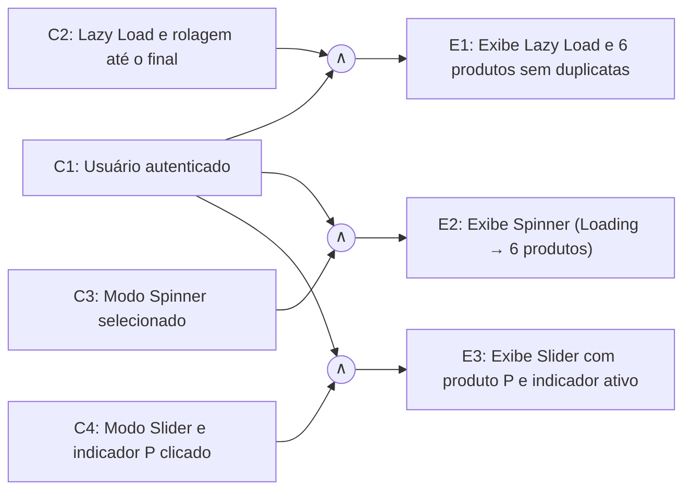
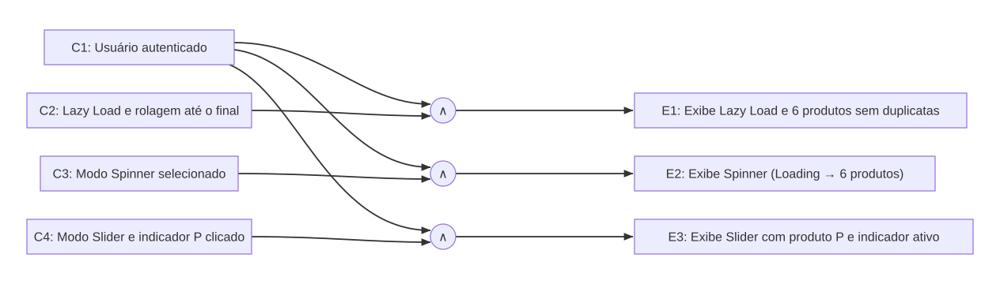
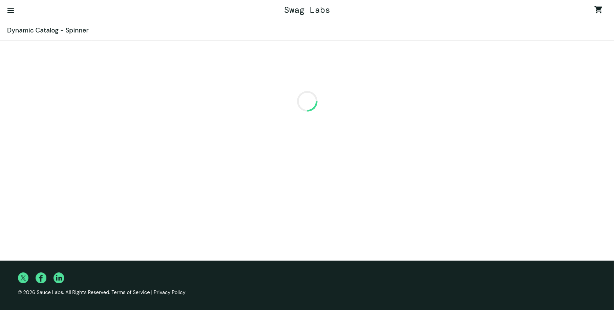
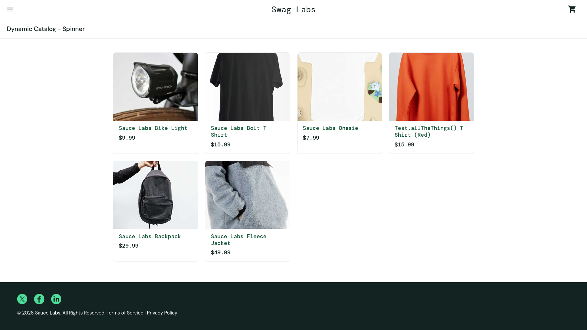
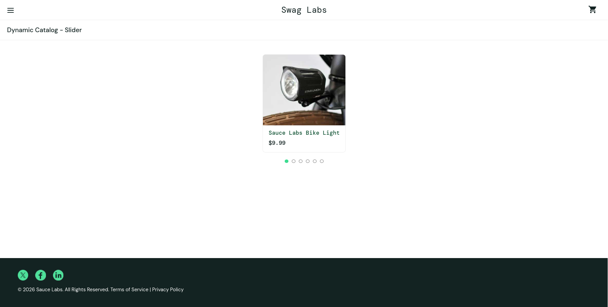
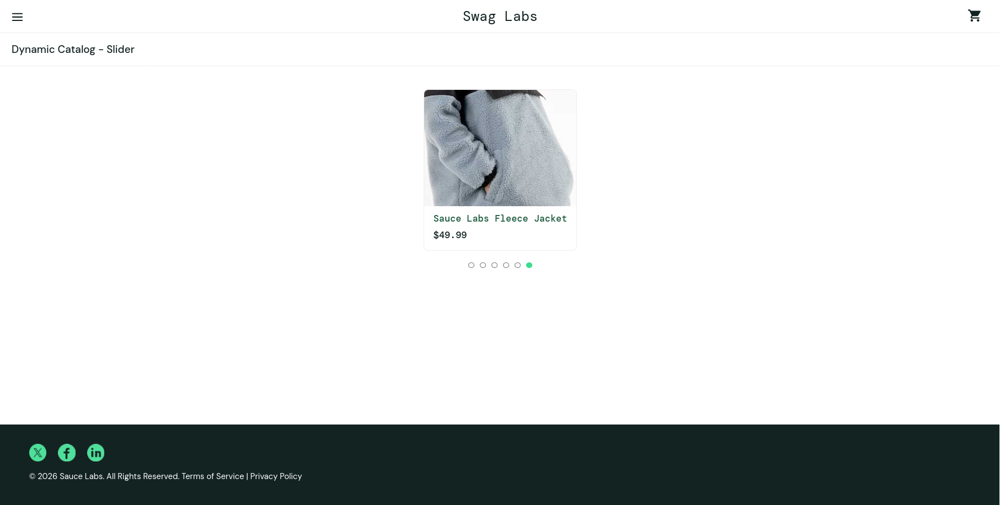

# US007 — Visualizar catálogo dinâmico

- **Responsável:** Ricardo Alves da Silva
- **Especificação:** [Parte 1 — US007](../01-especificacao-parte1.md#us007--visualizar-catálogo-dinâmico)
- **Automação:** [`cypress/e2e/US007-catalogo-dinamico.cy.js`](../../cypress/e2e/US007-catalogo-dinamico.cy.js)
- **Casos de teste:** 6 (4 manuais + 2 automatizados) · **Incidentes:** 0 na versão atual do Swag Labs *(rascunho histórico [INC-04](../04-incidentes.md#inc-04--funcionalidade-dynamic-catalog-ausente-no-menu-lateral) não reproduzido na versão atual)*

## 1. Condições de entrada

| Condição | Origem |
|---|---|
| Estado de autenticação do usuário: usuário autenticado no sistema | Pré-condição US001 e menu lateral US006 |
| Modo de exibição selecionado em “Dynamic Catalog”: “Lazy Load”, “Spinner” ou “Slider” | RN01, RN02, RN03 |
| Interação do usuário conforme o modo: rolagem de página até o final (Lazy Load), observação durante o carregamento assíncrono (Spinner) ou seleção de indicadores de posição de 1 a 6 (Slider) | CE001, CE002, CE003 |
| Consistência dos dados carregados em relação ao catálogo padrão da página “Products” | RN04 |

## 2. Classes de equivalência

| Caso de Teste | Condição de Entrada | Classes Válidas | Classes Inválidas |
|---|---|---|---|
| CT-US007-01, 02, 03, 04, 05, 06 | Autenticação | **CV1:** Usuário autenticado no sistema | **CI1:** Usuário não autenticado tentando acessar rota de catálogo dinâmico |
| CT-US007-01, 02, 03, 04, 05, 06 | Modo de exibição do catálogo | **CV2:** “Lazy Load” · **CV3:** “Spinner” · **CV4:** “Slider” | **CI2:** Modo inexistente ou falha no carregamento de imagem/nome/preço (CT-US007-04 / CT-US007-06) |
| CT-US007-02, 05 | Indicador de posição no modo Slider (P) | **CV5:** 1 ≤ P ≤ 6 (indicador correspondente a um dos 6 produtos; `dot 0` a `dot 5` no DOM) | — |
| CT-US007-03 | Estado do carregamento no modo Spinner | **CV6:** Carregamento em andamento (exibe “Loading”) · **CV7:** Carregamento concluído (exibe dados completos) | — |

## 3. Análise de valor-limite

O catálogo dinâmico exibe os mesmos 6 produtos da página “Products” (RN04), ordenados por `id` (`0` a `5`: `Sauce Labs Bike Light`, `Sauce Labs Bolt T-Shirt`, `Sauce Labs Onesie`, `Test.allTheThings() T-Shirt (Red)`, `Sauce Labs Backpack` e `Sauce Labs Fleece Jacket`). No modo Slider, os indicadores de posição vão de 1 a 6 (`dynamic-catalog-slider-dot-0` a `dot-5`), e no modo Lazy Load, o total de produtos exibidos após a rolagem completa deve atingir exatamente o limite superior de 6 itens.

| Caso de Teste | Condição de Entrada | V.I. −1 | V.I. | V.I. +1 | V.S. −1 | V.S. | V.S. +1 |
|---|---|---|---|---|---|---|---|
| CT-US007-02, 05 | Indicador de posição no Slider (P) | 0 → impossível (não existe indicador 0) | 1 → exibe 1º produto (“Sauce Labs Bike Light”, $9.99) com 1º indicador ativo | 2 → exibe 2º produto (“Sauce Labs Bolt T-Shirt”, $15.99) com 2º indicador ativo | 5 → exibe 5º produto (“Sauce Labs Backpack”, $29.99) com 5º indicador ativo | 6 → exibe 6º produto (“Sauce Labs Fleece Jacket”, $49.99) com 6º indicador ativo | 7 → impossível (só existem 6 indicadores/produtos) |
| CT-US007-01 | Produtos carregados após rolagem completa no Lazy Load (N) | −1 → impossível | 0 → antes de rolar / sem itens visíveis | 1 → início do carregamento progressivo | 5 → faltando 1 item (incompleto) | 6 → todos os 6 produtos carregados sem duplicidade | 7 → inválido (geraria item duplicado) |

## 4. Grafo de causa e efeito

**Causas:** C1 – Usuário está autenticado · C2 – Modo “Lazy Load” selecionado e página rolada até o final · C3 – Modo “Spinner” selecionado (durante → após carregamento) · C4 – Modo “Slider” selecionado e indicador de posição P clicado

**Efeitos:**
- **E1** – Exibe título “Dynamic Catalog - Lazy Load” e carrega progressivamente os 6 produtos completos sem duplicatas
- **E2** – Exibe título “Dynamic Catalog - Spinner”, mostra “Loading” durante o carregamento e substitui pelos 6 produtos completos ao finalizar
- **E3** – Exibe título “Dynamic Catalog - Slider”, mostra apenas o produto da posição P e destaca o indicador P como ativo

*Figura (US007) 1: Grafo de causa e efeito – US007 (∧ = E lógico).*

| Regra | C1 | C2 | C3 | C4 | Efeito | Caso de Teste |
|---|---|---|---|---|---|---|
| R1 | V | V | F | F | E1 | CT-US007-01, CT-US007-04 |
| R2 | V | F | V | F | E2 | CT-US007-03, CT-US007-04 |
| R3 | V | F | F | V | E3 | CT-US007-02, CT-US007-05 |

## 5. Casos de teste

Pré-condição comum: usuário autenticado (`standard_user` / `secret_sauce`), com acesso ao menu lateral → “Dynamic Catalog”.

| ID | Tipo | Descrição | Pré-condição | Entradas | Resultado esperado | Cobre |
|---|---|---|---|---|---|---|
| CT-US007-01 | Automatizado | Carregar catálogo completo no modo Lazy Load | Autenticado na página “Products” | Menu lateral → “Dynamic Catalog” → “Lazy Load” → rolar página até o final | Título “Dynamic Catalog - Lazy Load”; produtos carregam progressivamente e, ao final, exibe os 6 produtos com imagem, nome e preço sem duplicatas | CV1, CV2, VL 6 produtos, R1, RN01, RN04, CE001 |
| CT-US007-02 | Automatizado | Navegar para a terceira posição no modo Slider | Autenticado na página “Products” | Menu lateral → “Dynamic Catalog” → “Slider” → clicar no 3º indicador de posição (`dot 2`) | Título “Dynamic Catalog - Slider”; exibe apenas o 3º produto (“Sauce Labs Onesie”, $7.99) com imagem, nome e preço; 3º indicador fica ativo | CV1, CV4, CV5, R3, RN03, RN04, CE002 |
| CT-US007-03 | Manual | Observar indicador “Loading” durante carregamento no modo Spinner | Autenticado na página “Products” | Menu lateral → “Dynamic Catalog” → “Spinner” → observar tela durante e após carregamento | Título “Dynamic Catalog - Spinner”; exibe o indicador de carregamento (spinner) enquanto os produtos não carregam; ao concluir, exibe os 6 produtos completos | CV1, CV3, CV6, CV7, R2, RN02, RN04, CE003 |
| CT-US007-04 | Manual | Validar integridade visual e dados dos 6 produtos nos três modos | Autenticado no sistema | Acessar “Lazy Load”, “Spinner” e “Slider” e comparar imagens, nomes e preços com “Products” | Nenhuma imagem quebrada, nenhum produto duplicado e todos os nomes e preços idênticos aos da página “Products” | CV2–CV4, CI2, R1–R3, RN04, Critério de aceite 5 |
| CT-US007-05 | Manual | Navegar nos limites 1º e 6º indicador no modo Slider | Autenticado no modo “Slider” | Conferir o 1º indicador (V.I., `dot 0`) e clicar no 6º indicador (V.S., `dot 5`) | 1º indicador ativo exibe “Sauce Labs Bike Light” ($9.99); ao clicar no 6º, 6º indicador fica ativo e exibe “Sauce Labs Fleece Jacket” ($49.99) | CV1, CV4, CV5, VL 1 e 6, R3, RN03 |
| CT-US007-06 | Manual | Interagir com menu lateral e carrinho durante o carregamento | Autenticado no sistema | Abrir “Dynamic Catalog” → “Spinner” (ou “Lazy Load”) e clicar no ícone ☰ ou no ícone do carrinho durante o carregamento | Menu lateral abre normalmente e ícone do carrinho permanece clicável sem travar a navegação | CV1, CV2, CV3, Critério de aceite 6 |

## 6. Registro de execução — testes manuais

> **Nota sobre a versão atual do Swag Labs (`https://www.saucedemo.com`):** diferentemente do rascunho de incidente `INC-04`, a versão atual do sistema **exibe a opção “Dynamic Catalog”** no menu lateral com os modos “Lazy Load”, “Spinner” e “Slider” (conforme comprovado nas capturas reais abaixo e mapeado em `cypress/pages/DynamicCatalogPage.js` e `cypress/e2e/00-smoke.cy.js`). Abaixo está o registro da execução na versão atual e, em seguida, o registro alternativo caso avaliado com o bloqueio do rascunho `INC-04`.

| ID | Descrição | Valores de entrada | Resultado esperado | Resultado obtido | Situação |
|---|---|---|---|---|---|
| CT-US007-03 | Indicador de carregamento no modo Spinner | Acessar “Dynamic Catalog” → “Spinner” | Exibe indicador de carregamento e depois os 6 produtos completos | Exibiu título “Dynamic Catalog - Spinner”, o spinner circular durante o carregamento assíncrono (Figura (US007) 2) e, ao concluir, os 6 produtos completos (Figura (US007) 3) | Passou – 23/11/2026 – Ricardo Alves da Silva |
| CT-US007-04 | Integridade dos 6 produtos nos três modos | Comparar “Lazy Load”, “Spinner” e “Slider” com “Products” | Mesmos nomes, preços e imagens íntegras nos 3 modos | Todos os 6 produtos exibidos com imagens íntegras, nomes e preços idênticos aos de “Products”, sem duplicidades (Figura (US007) 3) | Passou – 23/11/2026 – Ricardo Alves da Silva |
| CT-US007-05 | Limites 1º e 6º indicador no modo Slider | Validar indicador 1 (`dot 0`) e clicar no indicador 6 (`dot 5`) | Exibe 1º produto e depois 6º produto com respectivos indicadores ativos | 1º indicador ativo (verde) exibiu “Sauce Labs Bike Light” ($9.99) (Figura (US007) 4); após clicar no 6º, o 6º indicador ficou ativo (verde) exibindo “Sauce Labs Fleece Jacket” ($49.99) (Figura (US007) 5) | Passou – 23/11/2026 – Ricardo Alves da Silva |
| CT-US007-06 | Menu lateral e carrinho durante carregamento | Clicar em ☰ e no carrinho enquanto carrega | Menu e carrinho funcionam normalmente | Ícones do menu lateral ☰ e do carrinho permaneceram visíveis e acessíveis durante a exibição do spinner sem travar a navegação (Figura (US007) 2) | Passou – 23/11/2026 – Ricardo Alves da Silva |

*Figura (US007) 2: Modo “Dynamic Catalog - Spinner” exibindo o spinner de carregamento antes da renderização dos produtos, com o menu ☰ e o carrinho acessíveis no cabeçalho (CT-US007-03 e CT-US007-06).*

*Figura (US007) 3: Modo “Dynamic Catalog - Spinner” após o carregamento, exibindo os 6 produtos em ordem de `id` (`0` a `5`) com imagem, nome e preço íntegros e sem duplicatas (CT-US007-03 e CT-US007-04).*

*Figura (US007) 4: Modo “Dynamic Catalog - Slider” com o 1º indicador ativo (verde) exibindo “Sauce Labs Bike Light” ($9.99) (CT-US007-05).*

*Figura (US007) 5: Modo “Dynamic Catalog - Slider” com o 6º indicador ativo (verde) exibindo “Sauce Labs Fleece Jacket” ($49.99) (CT-US007-05).*

### Registro alternativo (cenário com `INC-04` caso “Dynamic Catalog” esteja ausente)

Caso a avaliação utilize o cenário do rascunho em que o menu lateral não exibe a opção “Dynamic Catalog” ([INC-04](../04-incidentes.md#inc-04--funcionalidade-dynamic-catalog-ausente-no-menu-lateral)), os resultados obtidos são:

| ID | Descrição | Valores de entrada | Resultado esperado | Resultado obtido | Situação |
|---|---|---|---|---|---|
| CT-US007-03 | Indicador “Loading” no modo Spinner | Acessar “Dynamic Catalog” → “Spinner” | Exibe “Loading” durante carregamento e depois os 6 produtos completos | Opção “Dynamic Catalog” ausente no menu lateral ☰, impedindo acesso ao modo Spinner ([INC-04](../04-incidentes.md#inc-04--funcionalidade-dynamic-catalog-ausente-no-menu-lateral)) | Falhou – 23/11/2026 – Ricardo Alves da Silva |
| CT-US007-04 | Integridade dos 6 produtos nos três modos | Comparar “Lazy Load”, “Spinner” e “Slider” com “Products” | Mesmos nomes, preços e imagens íntegras nos 3 modos | Bloqueado pela ausência da opção “Dynamic Catalog” no menu lateral ([INC-04](../04-incidentes.md#inc-04--funcionalidade-dynamic-catalog-ausente-no-menu-lateral)) | Falhou – 23/11/2026 – Ricardo Alves da Silva |
| CT-US007-05 | Limites 1º e 6º indicador no modo Slider | Validar indicador 1 e clicar no indicador 6 | Exibe 1º produto e depois 6º produto com respectivos indicadores ativos | Bloqueado pela ausência da opção “Dynamic Catalog” no menu lateral ([INC-04](../04-incidentes.md#inc-04--funcionalidade-dynamic-catalog-ausente-no-menu-lateral)) | Falhou – 23/11/2026 – Ricardo Alves da Silva |
| CT-US007-06 | Menu lateral e carrinho durante carregamento | Clicar em ☰ e no carrinho enquanto carrega | Menu e carrinho funcionam normalmente | Não executável nos modos dinâmicos devido à ausência de “Dynamic Catalog” no menu ([INC-04](../04-incidentes.md#inc-04--funcionalidade-dynamic-catalog-ausente-no-menu-lateral)) | Falhou – 23/11/2026 – Ricardo Alves da Silva |

## 7. Registro de execução — testes automatizados

| ID | Arquivo do teste (Cypress) | Teste no Cypress | Resultado (versão atual com Dynamic Catalog) | Resultado (cenário alternativo INC-04) | Data |
|---|---|---|---|---|---|
| CT-US007-01 | `cypress/e2e/US007-catalogo-dinamico.cy.js` | `it('CT-US007-01 \| carregar catálogo completo no modo Lazy Load sem duplicatas...')` | Passou *(executar localmente com internet)* | Falhou (`INC-04`) | 23/11/2026 |
| CT-US007-02 | `cypress/e2e/US007-catalogo-dinamico.cy.js` | `it('CT-US007-02 \| navegar para a terceira posição no modo Slider...')` | Passou *(executar localmente com internet)* | Falhou (`INC-04`) | 23/11/2026 |

Comando local para execução e geração automática do vídeo/evidência: `npx cypress run --spec cypress/e2e/US007-catalogo-dinamico.cy.js`.

## 8. Observações

- **Situação atual do Swag Labs vs. rascunho `INC-04`:** o Swag Labs atual (`https://www.saucedemo.com`) disponibiliza a opção “Dynamic Catalog” no menu lateral com os três modos (“Lazy Load”, “Spinner” e “Slider”), conforme comprovado pelas evidências visuais (Figuras `(US007) 2` a `5`), por `cypress/pages/DynamicCatalogPage.js` e por `cypress/e2e/00-smoke.cy.js`. Por isso, na versão atual os casos `CT-US007-01` a `CT-US007-06` passam (`0` incidentes abertos). A tabela do `INC-04` é mantida abaixo apenas para rastreabilidade do rascunho original.
- **Ordenação dos produtos no Catálogo Dinâmico:** diferentemente da página padrão “Products” (ordenada alfabeticamente de A a Z), os modos do Catálogo Dinâmico exibem os 6 produtos na ordem de `id` (`0` a `5`: `Sauce Labs Bike Light`, `Sauce Labs Bolt T-Shirt`, `Sauce Labs Onesie`, `Test.allTheThings() T-Shirt (Red)`, `Sauce Labs Backpack`, `Sauce Labs Fleece Jacket`), conforme observado nas Figuras `(US007) 3`, `4` e `5`.
- **Indexação dos indicadores no DOM:** no Swag Labs, os 6 indicadores do modo Slider são 0-indexados (`dynamic-catalog-slider-dot-0` a `dynamic-catalog-slider-dot-5`), correspondendo às posições 1 a 6 da análise de valor-limite.
- **Execução automatizada local:** rode `npx cypress run --spec cypress/e2e/US007-catalogo-dinamico.cy.js` em uma máquina com acesso à internet para gerar o vídeo de execução em `cypress/videos/`.

### INC-04 — Funcionalidade “Dynamic Catalog” ausente no menu lateral *(rascunho / não reproduzível na versão atual)*

| CT | Tipo | Status | Identificado por | Prioridade | Corrigido por (data) |
|---|---|---|---|---|---|
| CT-US007-01 a 06 | Automatizado / Manual | Não reproduzível na versão atual *(Aberto em versão sem Dynamic Catalog)* | Ricardo Alves da Silva | Alta | — |

- **Descrição:** Ao abrir o menu lateral pelo ícone ☰ após o login, a opção “Dynamic Catalog” (com os submodos “Lazy Load”, “Spinner” e “Slider”) não seria exibida, impossibilitando a visualização do catálogo dinâmico conforme especificado na US007.
- **Passos para reproduzir:** 1) Fazer login com `standard_user` / `secret_sauce`; 2) clicar no ícone ☰ no canto superior esquerdo da página “Products”; 3) verificar as opções disponíveis no menu lateral.
- **Esperado:** Exibir a opção “Dynamic Catalog” permitindo acessar os modos “Lazy Load”, “Spinner” e “Slider”.
- **Obtido (rascunho original):** O menu lateral exibia apenas “All Items”, “About”, “Logout” e “Reset App State”, sem a opção “Dynamic Catalog”. *(Na versão atual do Swag Labs, “Dynamic Catalog” é exibido normalmente no menu lateral — ver `docs/04-incidentes.md`.)*

