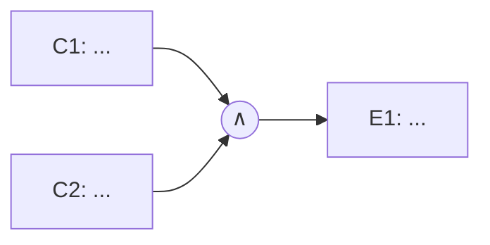

# USxxx — <Título da US>

> Copie este arquivo para `USxxx-nome-curto.md`. Exemplo completo: [US001-login.md](US001-login.md).

- **Responsável:** <seu nome>
- **Especificação:** [Parte 1 — USxxx](../01-especificacao-parte1.md#usxxx--titulo)
- **Automação:** [`cypress/e2e/USxxx-nome-curto.cy.js`](../../cypress/e2e/USxxx-nome-curto.cy.js)

## 1. Condições de entrada

O que o usuário pode variar nesta funcionalidade (campos, opções, estado do carrinho, sessão, URL…). Cite a RN de origem.

| Condição | Origem |
|---|---|
| | RN0x |

## 2. Classes de equivalência

| Caso de Teste | Condição de Entrada | Classes Válidas | Classes Inválidas |
|---|---|---|---|
| CT-USxxx-01 | | **CV1:** | **CI1:** |

## 3. Análise de valor-limite

| Caso de Teste | Condição de Entrada | V.I. −1 (inválido) | V.I. | V.I. +1 (válido) | V.S. −1 (válido) | V.S. | V.S. +1 (inválido) |
|---|---|---|---|---|---|---|---|
| CT-USxxx-0x | | | | | | | |

## 4. Grafo de causa e efeito *(quando aplicável — apague se não se aplicar e justifique)*

**Causas:** C1 – … · C2 – …
**Efeitos:** E1 – … · E2 – …

| Regra | C1 | C2 | Efeito |
|---|---|---|---|
| R1 | | | |

## 5. Casos de teste

| ID | Tipo | Descrição | Pré-condição | Entradas | Resultado esperado | Cobre |
|---|---|---|---|---|---|---|
| CT-USxxx-01 | Manual | | | | | CV1, RN0x |
| CT-USxxx-02 | Automatizado | | | | | CI1, VL |

## 6. Registro de execução — testes manuais

| ID | Funcionalidade | Descrição | Entradas | Valor da Entrada | Resultado esperado | Resultado do Testador 1 (<nome>) | Resultado do Testador 2 (<nome>) |
|---|---|---|---|---|---|---|---|
| CT-USxxx-01 | | | | | | Data: dd/11/2026. Passou / Falhou – ver Figura X | |

Evidências: salve os prints em `docs/img/USxxx-*.png` e referencie aqui: ``.

## 7. Registro de execução — testes automatizados

| ID | Teste no Cypress | Resultado | Data |
|---|---|---|---|
| CT-USxxx-02 | `it('CT-USxxx-02 \| ...')` | Passou / Falhou (ver resumo do `npm test`) | |

## 8. Observações

Dificuldades, comportamentos inesperados, decisões tomadas.
