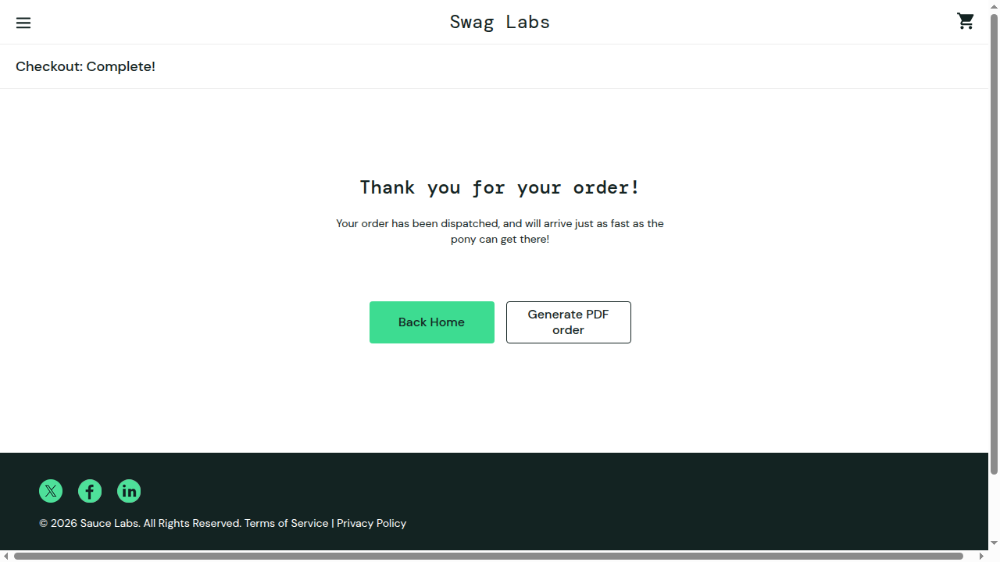
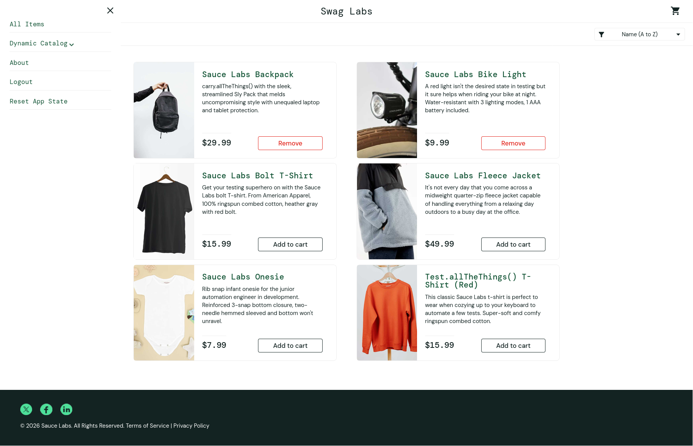

# Registro de Incidentes

Todo CT que **falhar** (manual ou automatizado) gera um incidente aqui. O Swag Labs é um sistema de terceiros, então a coluna “correção” registra o status do reteste — não esperamos correção do desenvolvedor.

**Prioridade:** Alta (bloqueia compra/login ou valor errado) · Média (funcionalidade incorreta com contorno) · Baixa (visual/texto).
**Status:** Aberto · Pronto para testar novamente · Fechado · Não reproduzível.

## Incidentes dos testes manuais

### INC-01 — Checkout é concluído com o carrinho vazio

| ID | Status | Responsável pela identificação | Prioridade de correção | Descrição do erro | Data e nome de quem corrigiu |
|---|---|---|---|---|---|
| CT-US005-05 | Aberto | Luis Felipe Holanda Martins | Alta | O sistema permite iniciar e concluir o checkout com o carrinho vazio, contrariando a US005 RN02 – ver Figura (US005) 2 | — |

**Passos para reproduzir:**
1. Login com `standard_user` / `secret_sauce`, sem adicionar produtos.
2. Clicar no ícone do carrinho → página “Your Cart” vazia.
3. Clicar em “Checkout”, preencher `Maria` / `Silva` / `62900-000` e clicar em “Continue”.
4. Clicar em “Finish”.

**Esperado (US005 RN02 e critério de aceite “Não deve permitir iniciar o checkout com o carrinho vazio”):** o botão “Checkout” não deve permitir avançar com o carrinho vazio.
**Obtido:** o botão está habilitado; o Overview mostra “Item total: $0”, “Tax: $0.00”, “Total: $0.00”; após “Finish” aparece “Thank you for your order!”.
**Reprodutibilidade:** reproduzido em 07/11/2026 (repetir antes da entrega para confirmar).

### INC-0N — <título curto do defeito>

| ID | Status | Responsável pela identificação | Prioridade de correção | Descrição do erro | Data e nome de quem corrigiu |
|---|---|---|---|---|---|
| CT-USxxx-NN | Aberto | <nome> | Média | <o que aconteceu × o que era esperado> – ver Figura X | — |

**Passos para reproduzir:** 1. … 2. … 3. …
**Esperado (RN0x / CE0xx):** … · **Obtido:** … · **Reprodutibilidade:** sempre / intermitente (x de y)

## Incidentes dos testes automatizados

### INC-03 — Botões “Remove” não voltam para “Add to cart” após “Reset App State”

| ID | Status | Responsável pela identificação | Prioridade de correção | Descrição do erro | Data e nome de quem corrigiu |
|---|---|---|---|---|---|
| CT-US006-02, CT-US006-05 | Aberto | Arthur Gomes Menezes | Alta | Ao clicar em “Reset App State” com itens no carrinho, o sistema oculta o contador do carrinho, mas os botões dos produtos na listagem permanecem como “Remove” em vez de retornarem para “Add to cart”, contrariando a US006 RN03 e o CE002 – ver Figura (US006) 8 | — |

**Tipo:** Automatizado (`CT-US006-02`) e Manual (`CT-US006-05`).
**Passos para reproduzir:**
1. Fazer login com `standard_user` / `secret_sauce`.
2. Clicar em “Add to cart” em dois produtos (ou nos 6 produtos, no `CT-US006-05`).
3. Abrir o menu lateral pelo ícone ☰.
4. Clicar em “Reset App State”.

**Esperado (US006 RN03 e CE002):** o carrinho é esvaziado, o contador some e os botões dos produtos voltam a exibir “Add to cart” imediatamente, mantendo o usuário autenticado.
**Obtido:** o contador do carrinho some (e o carrinho fica vazio), porém os botões na página “Products” continuam exibindo “Remove” (exigindo recarregamento manual da página para atualizar). No `CT-US006-02` (Cypress), a asserção que verifica o texto `"Add to cart"` no botão falha porque o texto permanece `"Remove"`.
**Reprodutibilidade:** sempre.
**Evidência:** ao executar `npx cypress run --spec cypress/e2e/US006-menu-lateral.cy.js`, o print automático da falha é salvo em `cypress/screenshots/` e o vídeo em `cypress/videos/` (copiar o print para `docs/img/US006-INC-03-reset-app-state-remove.png`).

### INC-0N — <título curto do defeito>

| ID | Status | Responsável pela identificação | Prioridade de correção | Descrição do erro | Data e nome de quem corrigiu |
|---|---|---|---|---|---|
| CT-USxxx-NN | Aberto | <nome> | Média | <mensagem de falha do Cypress> – ver Figura X | — |

Evidência: print gerado automaticamente em `cypress/screenshots/` e vídeo em `cypress/videos/` (copie o print para `docs/img/`).
