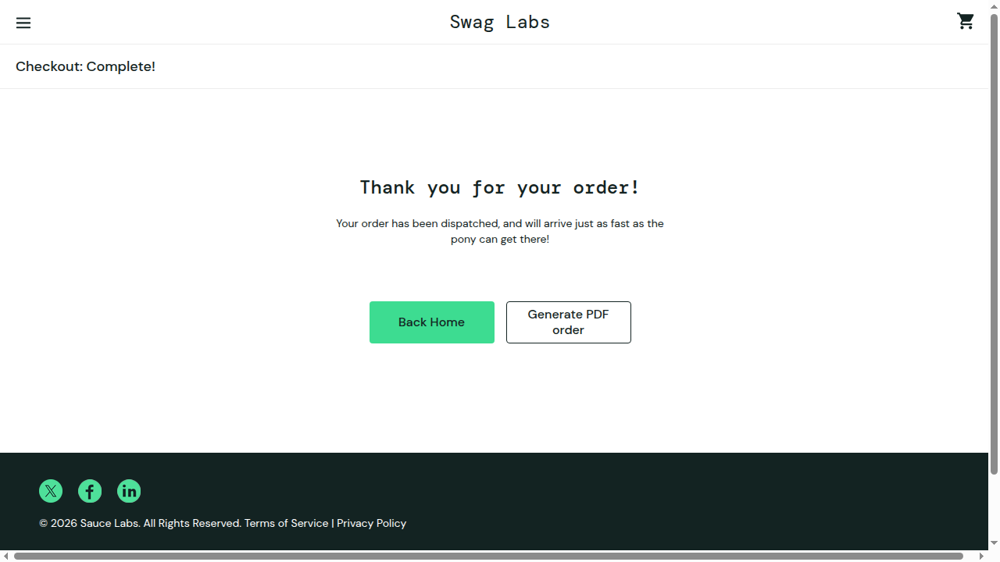

# Registro de Incidentes

Todo CT que **falhar** (manual ou automatizado) gera um incidente aqui. O Swag Labs é um sistema de terceiros, então a coluna “correção” registra o status do reteste — não esperamos correção do desenvolvedor.

**Prioridade:** Alta (bloqueia compra/login ou valor errado) · Média (funcionalidade incorreta com contorno) · Baixa (visual/texto).
**Status:** Aberto · Pronto para testar novamente · Fechado · Não reproduzível.

## Incidentes dos testes manuais

### INC-01 — Checkout é concluído com o carrinho vazio

| ID | Status | Responsável pela identificação | Prioridade de correção | Descrição do erro | Data e nome de quem corrigiu |
|---|---|---|---|---|---|
| CT-US005-05 | Aberto | Luis Felipe Holanda Martins | Alta | O sistema permite iniciar e concluir o checkout com o carrinho vazio, contrariando a US005 RN02 – ver Figura (US005) 2 | — |

**Passos para reproduzir:**
1. Login com `standard_user` / `secret_sauce`, sem adicionar produtos.
2. Clicar no ícone do carrinho → página “Your Cart” vazia.
3. Clicar em “Checkout”, preencher `Maria` / `Silva` / `62900-000` e clicar em “Continue”.
4. Clicar em “Finish”.

**Esperado (US005 RN02 e critério de aceite “Não deve permitir iniciar o checkout com o carrinho vazio”):** o botão “Checkout” não deve permitir avançar com o carrinho vazio.
**Obtido:** o botão está habilitado; o Overview mostra “Item total: $0”, “Tax: $0.00”, “Total: $0.00”; após “Finish” aparece “Thank you for your order!”.
**Reprodutibilidade:** reproduzido em 07/11/2026 (repetir antes da entrega para confirmar).

### INC-0N — <título curto do defeito>

| ID | Status | Responsável pela identificação | Prioridade de correção | Descrição do erro | Data e nome de quem corrigiu |
|---|---|---|---|---|---|
| CT-USxxx-NN | Aberto | <nome> | Média | <o que aconteceu × o que era esperado> – ver Figura X | — |

**Passos para reproduzir:** 1. … 2. … 3. …
**Esperado (RN0x / CE0xx):** … · **Obtido:** … · **Reprodutibilidade:** sempre / intermitente (x de y)

## Incidentes dos testes automatizados

### INC-0N — <título curto do defeito>

| ID | Status | Responsável pela identificação | Prioridade de correção | Descrição do erro | Data e nome de quem corrigiu |
|---|---|---|---|---|---|
| CT-USxxx-NN | Aberto | <nome> | Média | <mensagem de falha do Cypress> – ver Figura X | — |

Evidência: print gerado automaticamente em `cypress/screenshots/` e vídeo em `cypress/videos/` (copie o print para `docs/img/`).
